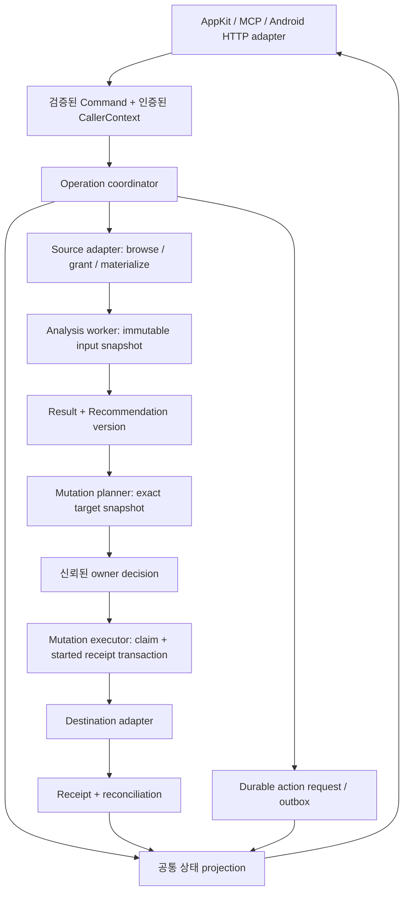

# PhotosMcp 전반 재설계: 구조·계약·데이터·작업 생명주기 독립 감사

- 감사일: 2026-10-06, architecture 담당.
- 대상: `/Volumes/ExtData/01_Projects/PhotosMcp/photos-mcp`의 현재 작업 트리.
- 목적: 구현 변경 전 증거 기반 재설계·개선 작업 계획. 이 문서의 제안은 아직 구현된 계약이 아니다.
- 현행 문서 기준: `docs/README.md`, `docs/03-integration`, `docs/04-architecture`, `docs/06-development/02-testing.md`. `docs/99-archive`는 현행 계약으로 사용하지 않았다.
- 범위: API/MCP, application 및 vendor 경계, 승인, 저장소, 실행/취소/재개/복구, 테스트와 문서 부채. 화면·Story 연출 상세는 다른 담당의 결과와 통합한다. Story는 작업·저장·공개/소유자 경계만 다룬다.
- 변경 제한: 이 문서만 작성. 시작 시 `src/photos_mcp/interfaces/appkit/people/controller.py`의 기존 수정이 확인되었으며 변경·되돌림하지 않았다. 다른 담당의 파일도 수정하지 않았다.
- 안전 제한: 라이브 사진 보관함/개인 사진/실제 DB 내용을 읽거나 출력하지 않았다. 사진·앨범 쓰기, 클라우드/키체인 변경, 실제 AI 실행, 앱/daemon 시작, 실제 HTTP endpoint 호출을 하지 않았다.

## 1. 결론과 증거 해석

현재 구현은 단순한 네 도구 MCP scaffold를 넘어 Apple/local/Google/GCS 입력, 선별, 추천의 로컬 원본 보관, 클라우드 게시, 인물 동의·계보, Android 소유자 API와 GPS 원장을 포함한다. 계층 디렉토리와 승인/영수증/버전 원장은 이미 좋은 기반이다. 전면 교체보다 **하나의 실행 계약, 승인된 명령 실행기, 저장소 마이그레이션 계약, 네트워크 신뢰 경계**를 기존 기능 위에 정착시키는 방향이 적합하다. PyObjC/AppKit 또는 Android 구현을 다른 프레임워크로 전환할 필요를 이 감사는 주장하지 않는다.

가장 먼저 해결할 항목은 승인 대기 작업의 목록 누락(ARCHITECTURE-01), 잘못된 options의 기본 범위 실행(02), 문서와 실제 승인 단계 불일치(03), 내부 쓰기 실행 경계 및 재개 경로(04), import workflow의 실제 의미 불일치(05)다. 운영 신뢰성 측면에서는 worker 생명주기(06–07), 소비된 승인과 영수증의 원자성(08), 목적지별 재조정(09), 저장소 백업/마이그레이션(10–11)이 뒤따른다.

증거 표기는 다음과 같다.

| 표기 | 의미와 한계 |
| --- | --- |
| **E1 직접 재현** | 이번 감사에서 메모리 DB/합성 입력만으로 실행하여 확인. 실제 앱/보관함/AI 결과를 의미하지 않음 |
| **E2 격리 자동 테스트** | 이번 감사에서 기존 테스트를 실행. 해당 테스트 범위만 검증되며 제품 E2E가 아님 |
| **E3 코드 확정** | 제시된 코드 분기·스키마·문서에서 직접 확인. 사용자 환경 발생 여부는 별개 |
| **E4 영향 추론** | 코드 연결로 추정한 실패/보안/운영 영향. 장애 주입·설치본 검증 전에는 확정 장애로 표현하지 않음 |
| **U 미검증** | 라이브 권한/실사진/네트워크/설치본/프로세스 종료/대규모 성능 등 이번에 실행하지 않은 사항 |

우선순위는 P1=다음 기능 확장 전 사용자 안전·작업 신뢰성에 필요한 항목, P2=구조/운영/계약을 안정화하는 항목, P3=후속 정리다. 라이브 노출이나 피해를 확인하지 않았으므로 P0 사고로 단정하지 않는다. 아래 23개 ID는 이번 감사에서 발견한 항목 전부이며 저장소 전체의 무결점 보증은 아니다.

## 2. 실제 구조와 기능 인벤토리

### 2.1 실행 표면과 책임

| 기능/표면 | 실제 구현 근거(저장소 상대 경로:줄) | 상태/쓰기/외부 경계 | 관련 테스트와 이번 검증 |
| --- | --- | --- | --- |
| AppKit composition root | `src/photos_mcp/app/main.py:90–113`, `app/lifecycle.py:94–203` | single-instance 이후 state/daemon 생성, MCP와 public share 별도 thread. 실제 AI 시작과 Maps 활성화는 CLI 진단과 분리 | `tests/test_main.py`, `test_daemon.py`; 이번 실행 안 함 |
| MCP 네 도구 | `interfaces/mcp/server.py:278–426`, `application/action_options.py:36–369` | query 18/select 4/write 9/workflow 6 = 37 action. 도구 개수와 기능 개수는 다름 | `tests/test_action_contract_docs.py:22–23`; E2 통과 |
| 조회·검색·원본 준비·취소 | `interfaces/mcp/facade/query_handler.py`, `infrastructure/vendor_adapter/photo_source.py:34–95`, `application/run_support.py:87–105` | 원본 변경 없는 조회와 resource 사용/prefetch/취소가 같은 query 도구에 섞임. latest는 active/recent 투영에 의존 | source contract 테스트 E2, 실제 iCloud/TCC는 U |
| 단일 사진 분석/범위 분류/우수 사진/특정 인물 선별 | `application/run_service.py:591`, `application/classification_service.py:165–250`, `application/selection_service.py`, `vendor/photo-ranker/jobs.py:80–175` | source 준비→VLM/얼굴/점수→결과. native 직접 호출과 MCP 호출이 공존 | `test_direct_classification.py`, `test_run_service.py`, `test_photo_ranker_job_queue.py`; 이번 실행 안 함 |
| Source/권한 계약 | `domain/policies/source_policy.py:21–43`, `application/source_registry.py:16–106`, `infrastructure/vendor_adapter/photo_source.py:34–88` | capability/grant 모델 존재. 실제 기본 경로는 vendor 문자열 source port도 사용 | `tests/test_source_contracts.py:31–80`; E2 통과 |
| Google Picker 입력과 임시 원본 lease | `application/google_photos_import_service.py:45–94`, `infrastructure/sources/google_photos/{picker,content,import_repository,session_repository}.py` | Google-origin을 local 파일 분석으로 materialize하되 origin_provider와 face_analysis_enabled=False 전달 | `test_google_photos_import_service.py`, `test_source_contracts.py:41–50`; 후자 E2 |
| 앨범/로컬/복합 내보내기 | `application/write_service.py:160–290,520–627`, `application/export_service.py:89–155` | MCP와 desktop에서 계획/승인/영수증. local 및 Apple 복합 목적지, 원본 준비/재시도 | `test_selected_export_bundle.py`, `test_selected_export_resume.py`, `test_desktop_export_service.py`; 이번 실행 안 함 |
| 승인·중복 방지·재조정 | `application/mutation_approval.py:102–262`, `infrastructure/persistence/run_repository.py:2566–2652`, `interfaces/mcp/server.py:80–139,297–366` | fingerprint/15분 TTL/approved 상태/원자 token 소비/receipt. 실제 목적지 쓰기는 별도 | `test_mutation_approval.py:79–107` 등 E2; 실제 쓰기는 U |
| 분석 후 정리 workflow | `application/workflow_service.py:99–219`, `interfaces/mcp/facade/public_tools.py:161–198,236–300` | 분석 결과 후 정확한 쓰기 계획. async task와 durable run 연결 | `test_public_tools.py:345` 등; 이번 실행 안 함 |
| 일일 자동화/복합 큐레이션/수동 작업 | `application/daily_curation.py:156,482`, `combined_curation.py:421,617,825`, `manual_curation.py:420–475,529,575` | 자동화 parent/child, Google 선택 및 GPS 사용자 대기, local recommendation materialize | `test_daily_curation.py`, `test_combined_curation.py`, `test_manual_curation.py`; 이번 실행 안 함 |
| 추천 원본 보관·버전·게시 | `application/recommendation_storage.py:155–178,403–445`, `recommendation_lifecycle.py:29–52`, `recommendation_publish.py:50`, `infrastructure/persistence/recommendation_versions.py` | SHA-256·atomic copy·managed root, 버전/그룹/목적지 영수증. 클라우드 게시 승인과 로컬 저장은 별개 | `test_recommendation_storage.py`, `test_recommendation_lifecycle.py`, `test_recommendation_publish.py`; 이번 실행 안 함 |
| 인물 식별·검토·계보·동의·자동 인식 | `application/person_identity_repository.py:47–48,268–724,3912–3950`, `person_indexing.py:119`, `people_automation_policy.py:61,127,151` | 별도 private SQLite, 관측/이름/소속/동의 revision, outbox 및 command receipt | `test_person_identity_repository.py`, `test_person_identity_lineage.py`, `test_people_automation_policy.py`; 이번 실행 안 함. UI 변경 파일 제외 |
| Android 소유자 API/명령/이벤트 | `interfaces/http/mobile_client.py:947–982,1170–1256,2990–3122`, `infrastructure/mobile_client/repository.py:36–58` | Bearer scope + P-256 body/path/nonce/time/idempotency 서명, GET/POST별 계약. 별도 auth DB | `test_mobile_client.py`, `test_mobile_client_server.py`; 이번 실행 안 함 |
| 모바일 GPS 및 로컬 위치 투영 | `infrastructure/mobile_location/ledger.py:79–104`, `application/location_privacy.py:145–181`, `application/mobile_location_projection.py` | 암호화 ingest ledger와 정확 GPS private columns, owner/share 투영 분리 | `tests/test_location_privacy.py`; E2 통과. Keychain/실 GPS는 U |
| Maps 장소 보강 | `app/main.py:98–103`, `infrastructure/google_location.py:204–244,325–342` | 실제 앱 실행 기본 활성화, 좌표 네트워크 전송, key는 env/Keychain 참조. 이번 조회하지 않음 | `test_google_location.py`; 이번 실행 안 함 |
| 소유자 웹/공유·파생 자산 | `interfaces/mcp/server.py:462–888`, `interfaces/http/story_web.py:1092–1129`, `app/lifecycle.py:139–156` | owner 인증/Origin 검사, 공유 서버 18792, source/derivative/reference 수명주기 | `test_story_sharing.py`, `test_story_generation.py`; 상세 Story 감사로 위임 |
| 운영/패키징/상태 | `operations/packaging`, `operations/validation`, `app/main.py:36–81`, `interfaces/mcp/server.py:213–255` | CLI health는 설정 snapshot, HTTP health는 state/capability. 둘은 다른 성공 근거 | `test_packaging.py`, `test_preflight.py`; 설치본 U |

표에서 디렉토리 또는 함수 시작 줄만 적은 항목은 기능 존재 인벤토리이며 개별 결함 증거는 아래 항목의 구체적인 분기를 따른다.

### 2.2 데이터 소유권과 저장소 지도

| 저장 대상 | 현재 위치/스키마 근거 | 소유/보존 계약의 필요한 구분 |
| --- | --- | --- |
| coordinator + ranker | `infrastructure/persistence/run_repository.py:28–30,84–434`, `vendor/photo-ranker/db.py:55–179` | 같은 jobs.db, 다른 연결/테이블/lock. workflow/run event/approval/receipt + job/results/checkpoint |
| legacy synthetic state | `state_store.py:490–516` | JSON 입력을 SQLite로 import; 신규 canonical 쓰기는 SQLite. backup 시 legacy JSON을 canonical로 오인하면 안 됨 |
| recommendation | `run_repository.py:231–368`, `recommendation_storage.py:403–445` | DB만으로 원본 보관 파일을 복구할 수 없음. 원본 복사/hash/relative path·목적지 receipt 함께 보존 |
| Story/version/derivative | `run_repository.py:369–434`, `recommendation_versions.py` | 원본 목록/snapshot/공유 package/파생 reference의 보존·삭제 정책은 구분해야 함 |
| people private | `person_identity_repository.py:47–48,268–724` | 별도 people DB, identity/state/name/consent/observation/decision/outbox. ranker known_faces만 백업해서는 부족 |
| Google Picker/lease/upload | `infrastructure/sources/google_photos/{session_repository,import_repository,upload_repository}.py` | 만료 grant·downloaded content와 upload receipt 수명은 다름. 만료 뒤 재개 시 재선택 필요 여부를 명시 |
| mobile owner auth | `mobile_client/repository.py:36–58,64–92` | device/session_version/challenge/token_hash. 장기 기기 등록과 단기 bearer를 분리 |
| mobile location ledger | `mobile_location/ledger.py:79–104` | encrypted payload 복원에는 DB 외 key 관리가 필요. 이 감사에서 key를 읽지 않음 |
| exact GPS / provider labels | `run_repository.py:285–328`, `location_privacy.py:145–181` | private exact 좌표와 owner/share safe labels, provenance·timezone 분리 |
| cache/model/log | `docs/04-architecture/04-storage-model.md:49–60`, `infrastructure/runtime/paths.py` | 삭제 가능한 cache, 영속 원본 복사, private face artifacts와 감사 기록을 하나의 cleanup 정책으로 묶지 않음 |

## 3. 발견 및 개선 옵션

### ARCHITECTURE-01 — 승인 대기 작업이 공통 작업 목록에서 사라짐 (P1)

**근거 E1/E3:** `interfaces/mcp/facade/public_tools.py:179–180`은 분석 후 `awaiting_mutation_approval`을 반환한다. `state_store.py:14–18,433–466`의 active/recent 집합에는 이 상태가 없고 snapshot은 두 집합으로만 작업을 투영한다. 메모리 state에 합성 run을 넣었을 때 DB에는 존재하지만 active=0, recent=0을 직접 재현했다. `run_support.py:87–105`의 latest 선택도 이 목록에 의존한다.

**영향:** 분석 완료 후 사용자 승인 대기가 작업 목록·latest 조회에서 누락될 수 있다. pending plan은 별도 목록에 남으므로 DB 유실과 같지는 않다. 실제 AppKit 화면 반영은 U.

**옵션/계획:** A(권장) 공통 상태 분류에 `action_required`를 추가하고 승인/Picker/GPS/재개 대기를 명시적으로 투영한다. B는 기존 active에 대기 상태를 추가하는 최소 보정이나 busy/resource-running과 혼동할 수 있다. 상태명 일괄 변경보다 기존 문자열을 읽는 호환 adapter부터 도입한다. 모든 상태의 active/history/action-required/result-available 기대표를 테스트하고 latest는 생성 순서·명시 run ID로 안정화한다. DB migration 없이 projection 수정→기존 pending plan 연결 backfill→Mac/Android/MCP 동일 run 확인 순으로 검증한다.

### ARCHITECTURE-02 — 잘못된 options가 빈 객체로 바뀌며 기본 Apple 범위로 해석됨 (P1)

**근거 E1/E3:** `application/action_options.py:372–383`은 JSON decode 실패, JSON 배열, 기타 타입을 `{}`로 바꾼다. `471–560`은 키/필수값 및 selected_photo_ids 일부만 검사한다. 합성 입력 `'{broken'`과 `'[]'`를 `select_best` validator에 전달했을 때 둘 모두 수락되어 default source=`apple`을 재현했다. public MCP signature는 dict/None(`server.py:291`)이므로 MCP SDK가 문자열을 먼저 거부할 수 있다. **확정 범위는 직접 facade/validator/호환 caller**이며 MCP wire 경로 발생은 U.

**영향:** caller의 명시 범위가 사라져 기본 범위 분석을 요청할 위험. `bool('false')`, `int(...)` 변환이 후단에 흩어져 타입 오류/오해도 발생 가능(`workflow_service.py:117–120`).

**옵션/계획:** A(권장) action별 typed request model과 엄격한 parse error를 적용. B는 현 ActionSpec에 타입·범위·enum/date/cross-field validators를 추가. key allowlist는 유지한다. 무효 JSON·array·boolean 문자열·NaN·음수/과도한 limit·날짜 역전·경로/source 누락을 거부하는 테스트를 작성한다. 구형 JSON 문자열 caller의 정상 dict 변환만 유지하고 무효 입력 기본 실행은 제거한다. breaking error code와 client retry 문서를 버전화한다.

### ARCHITECTURE-03 — 문서의 2단계 승인 설명과 실제 3단계 승인 상태가 다름 (P1)

**근거 E2/E3:** `docs/03-integration/02-tool-reference.md:111–124`, `docs/04-architecture/03-request-and-job-flow.md:69–74`는 같은 options+token 재호출을 설명한다. 실제 `mutation_approval.py:194–205`는 pending token을 `mutation_not_approved`로 거부한다. `run_repository.py:2566–2587`에서 별도 pending→approved decision 후 consume한다. `interfaces/appkit/menu/controller.py:1084,1123`에 앱 승인 진입점이 있다. `tests/test_mutation_approval.py:79–107` 및 pending token test가 이번 통과했다.

**영향:** MCP client가 사용자에게 승인받았다고 말한 후 token만 다시 보내면 계속 blocked. 안전 장치가 작동하는 것이므로 pending token 자동 승인으로 해결하면 안 된다.

**옵션/계획:** A(권장) 문서·guide·도구 description을 plan→신뢰된 앱 decision→execute로 정정하고 decision 채널/만료/거절/부분 실패를 명시. B는 별도 인증된 owner approval API를 설계하되 일반 MCP agent가 자기 요청을 승인하지 못하도록 한다. 동일 API/문서 fixture에서 상태와 error/next-action 계약을 검증한다. 기존 token은 유지하고 응답 schema_version과 정확한 next step만 추가한다.

### ARCHITECTURE-04 — 승인 경계가 transport/desktop wrapper에 있고 일반 쓰기 use case는 직접 실행 가능 (P1)

**근거 E3, 영향 E4:** `server.py:297–366`과 `export_service.py:118–155`는 승인 확인을 수행한다. 반면 `write_service.py:160–183,221–285`는 options validation 후 mutation_plan이 없으면 selected를 다시 읽거나 photo_ids로 vendor write를 호출한다. 추천 publish/configure만 별도 approved plan 필수를 검사한다(`184–219`). `workflow_service.py:55–97`의 resume는 저장된 photos_write 요청을 내부 facade로 보내고, `interfaces/mcp/facade/public_tools.py:327–345`는 일반 handler로 위임한다. `workflow_service.py:146–160`은 state_store=None일 때 album writeback 분기도 보유한다.

**영향:** 현재 정상 앱 모든 경로가 우회한다는 의미는 아니다. 향후 새로운 UI/HTTP/복구 caller가 handler를 직접 연결하면 승인·exact set·receipt 보장이 빠질 구조다. resume 승인과 실제 쓰기 재승인의 관계도 분기마다 점검해야 한다.

**옵션/계획:** A(권장) `ApprovedMutationCommand`를 받는 중앙 executor로 쓰기 집중, planner와 executor 분리. 승인 context를 transport의 임의 dict 대신 repository에서 검증된 command ID로 조회한다. B는 각 handler에 guard를 추가하되 중복 정책의 회귀 비용이 크다. 모든 쓰기 entrypoint 목록을 만들고 승인 없는 직접 호출/오래된 대상/잘못된 source/resume를 fake writer로 차단하는 계약 테스트를 추가한다. legacy handler는 중앙 executor로 위임하는 호환 wrapper로 남긴 뒤 제거한다. 실사진 없이 충분히 검증 가능하다.

### ARCHITECTURE-05 — import_then_curate_to_album은 실제로 import_to_album으로만 변환됨 (P1)

**근거 E3:** `application/action_options.py:349–355`는 selection_profile/exclude_screenshots를 허용한다. 그런데 `server.py:372–383`은 action 검증 전에 photo_paths/album/folder/token만 추려 `photos_write(import_to_album)`로 전달한다. `write_service.py:608–618`의 동작은 import이며 선별 단계가 없다. 따라서 원래 workflow 옵션을 버리고 원본 전체 가져오기 계획으로 축소된다. `docs/03-integration/02-tool-reference.md:42`의 “가져오기와 앨범 선별”과 다르다. unknown workflow options도 이 변환에서 버려질 수 있다.

**영향:** 사용자가 선별된 소수만 앨범에 들어갈 것으로 기대해도 import 대상 전체를 승인할 수 있다. 여기서 즉시 무승인 write가 확인된 것은 아니다; import write 승인 gate는 유지된다.

**옵션/계획:** A는 import+curate의 정확한 순서와 두 mutation 범위를 구현. B(초기 권장)는 현 기능을 import alias로 명시하고 이 workflow를 deprecated/blocked 처리해 제품 약속을 줄인다. 임의로 사용자 사진을 먼저 가져온 후 선별하지 않는다. fake caller로 selection_profile 전달·workflow 검증·실제 plan 대상 수를 확인한다. 기존 automation caller를 조사한 후 문서/guide/action version과 alias migration을 함께 진행한다.

### ARCHITECTURE-06 — daemon 종료가 thread 실제 종료와 durable worker 정리를 보증하지 않음 (P1)

**근거 E3, 영향 E4:** `app/lifecycle.py:174–196`은 should_exit 후 10초 join을 수행하고 thread 생존 여부 검사 없이 참조를 None으로 바꾸며 stopped를 표시한다. `is_running`은 남아 있는 참조와 thread에 의존(`201–203`). background coordinator는 `public_tools.py:266–300`에서 asyncio task를 생성하고 runner는 Exception만 처리한다. vendor queue는 자체 tasks/semaphore(`vendor/photo-ranker/jobs.py:80–175`)를 사용한다. 문서 `02-runtime-lifecycle.md:38–46`의 worker/polling 정리 보장은 이 부분만으로 입증되지 않는다.

**영향:** timeout 뒤 old worker가 살아 있는데 stopped/restart가 표시되거나 cancellation durable status가 늦게 반영될 가능성. 프로세스 hang/중복 worker는 U.

**옵션/계획:** A(권장) composition root에서 worker registry와 ASGI lifespan을 소유; drain→cancel/await→checkpoint/receipt→DB flush/close→thread join 후 stopped. B는 별도 worker 프로세스 분리이나 현재 단계에서 비용이 크다. bounded shutdown 실패는 degraded/stopping과 worker count로 노출한다. fake blocker/cancellation/long writer/두 번 restart 테스트 후 설치본에서 비민감 fixture로 강제 종료 검증한다. 기존 active run은 resume approval 정책을 유지한다.

### ARCHITECTURE-07 — MCP 내 모바일 라우트 등록은 독립 서버의 worker lifespan을 연결하지 않음 (P1)

**근거 E3, 영향 E4:** `mobile_client.py:583–604`의 startup은 stale operation 재큐잉과 stale action 정리, shutdown은 dispatcher cancel/await를 한다. 독립 `build_mobile_client_app`은 이를 lifespan에 연결(`3125–3142`). `register_mobile_client_routes`는 handler만 등록하고 service를 반환(`3145–3151`); MCP `server.py:1402–1406`는 그 반환값을 사용하지 않고, FastMCP 생성(`258–276`)에 해당 lifespan이 없다. `_ensure_dispatcher`는 수동 start POST 이후에는 실행된다(`1254`)는 점도 구분한다.

**영향:** 앱 내 MCP에 등록된 경로는 독립 모바일 서버와 동일한 재시작/종료 복구를 제공한다고 볼 수 없다. 별도 모바일 서비스가 실제로 담당하는 배포라면 영향이 제한된다. 현재 실행 토폴로지는 U.

**옵션/계획:** A(권장) standalone/embedded가 같은 lifecycle service를 재사용하며 실행 소유자를 한 곳으로 지정. B는 embedded 경로를 read-only로 한정하고 control은 독립 service로 문서화. 각각 factory ASGI startup/shutdown에서 requeue/dispatcher 호출 횟수를 fake repository로 확인한다. topology capability에 owner/runtime ID를 노출하고 기존 queued operations를 동일한 IDs로 복구한다.

### ARCHITECTURE-08 — 승인 소비와 시작 영수증 저장 사이 crash window (P1)

**근거 E3, 영향 E4:** `mutation_approval.py:205–218`은 approved token을 소비한다. `run_repository.py:2579–2587`은 즉시 commit. 그 뒤 `server.py:341–345`가 started receipt를 별도 저장한다. `save_mutation_receipt` 자체는 receipt 저장과 plan 업데이트를 같은 commit으로 수행(`2630–2652`)하지만 앞선 consume과는 분리다. 소비 후 영수증이 없을 때 `mutation_approval.py:185–193`은 `mutation_already_consumed`로 block한다.

**영향:** 해당 간극에서 종료되면 무단 재실행을 막는 안전성은 있으나 사용자는 “소비됨, 영수증 없음” 상태에서 복구 근거를 잃는다. 실제 crash 재현은 U.

**옵션/계획:** A(권장) approved→claimed와 started receipt 삽입을 하나의 repository transaction으로 처리. 실행은 commit 이후 시작하고 lease/owner/started_at을 기록한다. B는 orphan consumed token 복구 도구이나 대상 상태 확인이 필요하다. consume 직전/직후/receipt 직후/writer 후 각각 fault injection으로 재시도 중복 0, receipt 존재, 사용자 조치 가능을 확인한다. 기존 orphan은 자동 재실행하지 않고 recovery record를 backfill한다.

### ARCHITECTURE-09 — 자동 재조정 지원이 일부 앨범 action에 한정됨 (P1)

**근거 E3:** `server.py:80–91`은 requested photo IDs가 있고 action이 add_selected_to_album/add_photo_ids_to_album인 경우만 실제 membership 재조회한다. import/cleanup/category/local export/recommendation publish에는 이 공통 recheck가 적용되지 않는다. `mutation_approval.py:147–163`은 started/reconciling/partial/failed receipt를 block한다. selected bundle과 recommendation에는 별도 destination receipt/재시도 경로가 있으므로 재조정 기능이 전혀 없다는 평가는 부정확하다.

**영향 E4:** 실패 후 action별 복구 방법이 달라 client는 같은 error_code만으로 안전한 다음 행동을 알기 어렵다. category/cleanup/import의 실제 대상 상태와 receipt 간 불일치는 U.

**옵션/계획:** A(권장) DestinationPort별 reconciliation 전략 + capability(`reconcile_supported`, `retry_requires_new_plan`, `remaining_set`)를 중앙 executor에 연결. B는 지원하지 않는 action에 명확한 수동 복구 안내를 제공. 목적지 상태가 unknown일 때 completed로 추정하지 않는다. partial/timeout/이미 존재/삭제된 목적지/외부 변경 시나리오를 fake destination으로 테스트하고 기존 receipt를 action별 adapter로 읽는다.

### ARCHITECTURE-10 — 현행 저장소 문서의 “원본 복제 없음”과 실제 managed 원본 복사가 충돌 (P1)

**근거 E3:** `docs/04-architecture/04-storage-model.md:7`은 원본을 복제하지 않는다고 설명한다. `recommendation_storage.py:155–175`는 source 전체를 temporary file로 copy 후 hash 검증·rename하고, `403–445`는 managed recommendation asset과 relative path를 저장한다. 이는 thumbnail cache만이 아니다. Google materialized 입력도 lease 기반 임시 파일을 만든다.

**영향:** 사용자 저장 용량·개인정보 보존·백업·정리 판단이 달라진다. “원본 보관함을 수정하지 않음”과 “원본 사본을 보관하지 않음”은 분리된 약속이어야 한다.

**옵션/계획:** A(권장) source original/materialized temporary/managed retained original/derivative/model cache/log 각각의 저장·삭제·승인·보존 표를 현행 문서와 제품 storage summary에 제공. B는 원본 복사 opt-in으로 제한하되 recommendation이 사본에 의존하므로 기능 검토가 필요하다. 기존 파일 삭제는 수행하지 않는다. hash/DB reference/volume-unavailable/partial copy/중복 방지 테스트를 연결하고 보존 manifest를 기존 레코드에서 backfill한다. retention 기본값은 UX/제품 담당과 결정한다.

### ARCHITECTURE-11 — 다중 DB·WAL·원본 사본의 일관된 백업/마이그레이션 계약 부족 (P1)

**근거 E3:** 저장 문서 `04-storage-model.md:12–47,58–60`은 주로 jobs.db와 runtime을 안내한다. 실제 people DB는 `person_identity_repository.py:47–48`, mobile auth DB는 `mobile_client/repository.py:36–58`, encrypted GPS ledger는 `mobile_location/ledger.py:79–104`, managed 원본은 10의 근거처럼 따로 존재한다. coordinator/ranker는 각각 schema create/ALTER(`run_repository.py:79–82,479–491`, `vendor/photo-ranker/db.py:272–278`)를 소유한다. coordinator에는 이 조사에서 순서 있는 schema migration/version gate가 확인되지 않았다. **people에는 repository_metadata/migration_runs와 version 테이블이 있으므로 프로젝트 전체에 migration이 없다는 주장은 하지 않는다.**

**영향 E4:** 앱 실행 중 SQLite 파일만 복사하면 WAL/외부 파일/다른 DB와 같은 시점의 snapshot이 아닐 수 있다. GPS key 없는 DB 복원, 새 schema→구버전 downgrade도 문서상 미정이다.

**옵션/계획:** A(권장) DB별 schema version + release compatibility matrix + SQLite backup API/일관 snapshot manifest를 정의. 최소 migration coordinator만 만들고 DB들을 성급히 합치지 않는다. 정지/읽기 잠금 정책, source/managed asset checksum, key 의존성을 기록하되 secret을 manifest에 넣지 않는다. old-schema fixture→새 release→중단→복원/rollback 테스트와 FK/integrity 검사를 포함한다. 운영 DB migration은 사전 backup 후 승인된 별도 작업에서 수행한다.

### ARCHITECTURE-12 — 승인 token과 상세 작업이 health 응답에 포함됨 (P1, 노출 영향 조건부)

**근거 E3:** `server.py:213–255`는 active/recent job와 `pending_mutation_plans`를 health에 그대로 넣고 `428–430`의 GET은 owner check를 하지 않는다. `state_store.py:417–418`는 pending plan 전체를 반환하고 `run_repository.py:2614–2620`의 직렬화에는 token이 포함된다. FastMCP constructor `server.py:265–276`에 앱 인증은 보이지 않으며 host는 env로 변경 가능(`app/config.py:73–74`). 기본 loopback와 SDK transport 보호는 존재할 수 있으므로 public 노출을 확인한 것은 아니다.

**영향 E4:** health를 proxy/public monitoring에 전달하면 승인 capability 및 대상/원본 경로 등 민감 계획 정보가 유출될 수 있다. token만으로 pending write는 승인되지 않지만 이미 approved/소유자 조작과 결합되는 공격면은 줄여야 한다. 실제 proxy reachability는 U.

**옵션/계획:** A(권장) `/health`는 status/count/schema/runtime version만 반환, 상세 diagnostics는 owner-auth endpoint. B는 상세 응답 opt-in으로 제한하되 default 최소화. fixture sentinel token/path/photo ID가 health 문자열에 없음을 테스트한다. 오래된 health consumer는 count/status를 유지하면서 상세 endpoint로 이행한다.

### ARCHITECTURE-13 — “loopback-only” 자동화 판단이 listener host에 의존 (P1, 배포 검증 필요)

**근거 E3:** `server.py:921–925,1170–1177`은 `config.host` 값으로 trigger/reconcile 접근을 제한한다. 요청의 인증/peer/proxy 경로를 이 gate에서 검사하지 않는다. 소유자 웹은 별도 `story_web.py:1092–1129`에서 Tailscale login 또는 loopback client와 Origin을 검사한다. 즉 서로 다른 신뢰 모델이다.

**영향 E4:** loopback listener가 reverse proxy로 공개될 경우 host 조건은 계속 통과한다. 실제 Tailscale 경로 공개 여부와 헤더 제거/삽입 정책은 U이며 현재 취약점 exploitation을 확인하지 않았다.

**옵션/계획:** A(권장) private automation listener를 별도 transport로 분리하고 인증된 service credential 또는 Unix socket을 사용. B는 공통 owner/service auth middleware와 explicit route allowlist. host env가 non-loopback이면 MCP까지 자동으로 안전하다고 가정하지 않는다. proxy/peer spoof/Origin/body 제한 테스트 및 승인된 배포 설정 read-only 확인 후 개선한다. ACL을 바꾸는 운영 단계는 독립 승인 작업이다.

### ARCHITECTURE-14 — local_only 오타는 원격 허용으로 해석되고 위치 외부 전송은 별도 정책 (P1)

**근거 E1/E3:** `vision/runtime.py:63–65`은 모르는 policy를 remote_allowed로 fallback한다. 합성 `local_ony`가 remote_allowed가 됨을 재현했다. `85–103`의 local_only는 VLM만 선택한다. `app/main.py:98–103`은 실제 앱 진입 시 Google location enabled 기본값 1을 설정하며 `google_location.py:325–333`은 exact GPS를 resolver로 넘긴다. adapter의 실제 네트워크 요청은 `225–244`. 문서 `05-security-and-privacy.md:30–38`는 VLM 정책에 초점이 있다.

**영향:** 잘못된 privacy 설정이 허용으로 내려가는 것은 직접 확인. local_only가 앱 전체 offline이라는 기대는 충족하지 않는다. 이번에는 좌표/키/네트워크를 실행하지 않았다.

**옵션/계획:** A(권장) invalid privacy enum은 fail-closed config error, 전송 유형별 정책(VLM 이미지/Maps GPS/browser mission/story director/cloud upload)과 capability reason을 분리. B는 단일 offline 모드를 추가하되 기존 remote_allowed 고객 호환성을 고려한다. 로컬-only 설정과 malformed policy에서 network stub 호출 0을 확인한다. 이전 env는 호환 translation으로 유지하고 startup에서 결정된 정책을 민감값 없이 표시한다.

### ARCHITECTURE-15 — Google-origin local materialization에서 정책 provenance가 중요함 (P2)

**근거 E2/E3:** `google_photos_import_service.py:58–68`은 source=local로 전달하면서 origin_provider=google_photos, face_analysis_enabled=False를 전달한다. `source_policy.py:34–43`은 capability를 검증하고 source contract 테스트는 Google face processing 금지를 확인했다. 다만 raw local 파일을 넘기는 모든 향후 caller가 이 provenance를 유지한다는 전역 보장은 없다.

**영향 E4:** 경계 리팩터링에서 local이라는 source만 보고 Google 정책을 놓치거나 lease expiry/cleanup 뒤 재개할 위험. 현재 bridge에 face guard가 없다는 주장은 하지 않는다.

**옵션/계획:** A(권장) 실행 snapshot에 provider/source_id/account/grant/lease/content hash와 immutable origin policy를 넣고 native/MCP/mobile 모두 같은 materialization result를 사용. B는 현 request_options에 provenance 필수 검사를 추가. 재개/selected export/recommendation copy/인물 indexing에서 origin과 expiry를 유지하는 fake lease 계약 테스트를 추가한다. 기존 origin 누락 레코드는 추론 확실도와 policy unknown을 표시하며 자동 얼굴 처리 대상으로 승격하지 않는다.

### ARCHITECTURE-16 — 계층 테스트가 문서의 전체 의존 경계를 강제하지 못함 (P2)

**근거 E2/E3:** `tests/architecture/test_dependency_rules.py:11–19`은 absolute AST imports만 수집한다. domain 금지 목록 `26–38`에는 stdlib sqlite3/network/filesystem이 없고 relative imports/dynamic import/string gateway 호출도 보지 않는다. application 금지 목록 `49–56`은 infrastructure를 허용한다. `docs/04-architecture/README.md:36–38`는 domain의 filesystem/network/SQLite 금지와 application concrete 기본 참조 예외를 설명한다. 이번 architecture 검사 3개는 통과했지만 이 통과는 전체 계층 준수 증거가 아니다.

**영향:** 새 서비스가 adapter/글로벌 상태를 직접 생성해도 일부 검사는 통과하며 fake-only 단위 테스트와 실제 실행의 차이가 커진다.

**옵션/계획:** A(권장) package import rules에 relative resolution/stdlib I/O/importlib 경계를 추가하고 composition root 예외를 이름·기한과 함께 allowlist. B는 서비스별 constructor port만 점진적으로 도입. architecture tests를 실제 규칙과 동기화하며, 무의미한 파일 크기 제한 대신 concrete creation/dynamic gateway 영향 경로를 검사한다. wrapper imports는 유지해 public import compatibility를 확인한다.

### ARCHITECTURE-17 — SourceRegistry·port 모델과 실제 vendor gateway 계약이 병존 (P2)

**근거 E3:** `source_registry.py:16–72`는 typed descriptor/capability adapter를 제공하지만 binding 필드는 Any다. `vendor_adapter/photo_source.py:34–88`의 실제 read port는 source 문자열/kwargs와 동적 method명으로 호출한다. `vendor_adapter/gateway.py:22–31`은 getattr/coroutine-or-thread/JSON decoding으로 payload를 받아 타입을 보장하지 않는다. `classification_service.py:173–179`는 concrete vendor port를 기본 생성한다.

**영향 E4:** capability catalog와 실제 허용 옵션/response shape가 별도 유지되어 source별 차이를 caller가 다시 해석해야 한다. 잘못된 JSON vendor 응답도 string으로 남을 수 있다.

**옵션/계획:** A(권장) browse/materialize/analyze/destination 단위의 typed adapter 결과를 정의하고 vendor는 infrastructure anti-corruption adapter 안에 둔다. B는 gateway에 method allowlist와 response validation부터 적용. 기존 `source=apple/local/gcs` aliases와 facade wrappers는 translation layer로 유지한다. provider별 동일 계약 fixture와 mismatch rejection을 확인하고 UI/HTTP가 vendor method name을 알지 않도록 이행한다.

### ARCHITECTURE-18 — 공통 응답·상태·ID 계약이 분산되고 오류가 단순 문자열로 투영됨 (P2)

**근거 E3:** `public_tools.py:25–35,109–158,223–231`은 default completed/terminal/result_available와 str(exc)를 정규화한다. `server.py:142–178`도 별도 정규화를 하고 `state_store.py:523` 이후는 JobSnapshot으로 투영한다. mobile에는 `application/mobile_client.py:40`의 envelope와 별도 projections가 있다. `run_support.py:32–58`은 nested error/detail 문자열을 다시 풀어낸다.

**영향 E4:** completed지만 result 없음, blocked지만 terminal 여부 미정, facade/vendor run ID 혼용 등 해석을 각 client가 해야 한다. str(exc)/detail에는 경로/외부 helper 정보가 포함될 가능성이 있다. 실제 비밀 유출은 확인하지 않았으며 safe mutation error와 mobile safe projection은 기존 보호다.

**옵션/계획:** A(권장) `OperationEnvelope`에 schema_version/operation_id/run_id/vendor_job_id/status/state_class/result_ref/error_code/safe_message/retry_policy/action_required를 명시하고 transport adapter만 모양을 바꾼다. B는 shared normalizer부터 도입. fake 예외에 token/path sentinel을 넣어 공개 응답 누락을 검증하고 private diagnostic reference만 보존한다. 구형 fields는 한 release 이상 읽기 호환으로 유지한다.

### ARCHITECTURE-19 — 자동화 부모·자식·사용자 조치의 연결을 하나의 작업 계약으로 설명하지 못함 (P2)

**근거 E3:** `manual_curation.py:437–473`은 operation 저장 후 user_action을 별도 저장한다. `combined_curation.py:421,617,825`는 parent/child 진행을 별도로 reconcile하고 `daily_curation.py:482`에도 다른 reconcile이 있다. `mobile_client.py:583–592`는 startup에 stale actions를 보정한다. 현행 `03-request-and-job-flow.md:25–59`는 주로 run_id+재개 계획만 설명한다.

**영향 E4:** 요청 1개에 여러 ID/상태가 있어 “왜 대기인지, 어떤 조치를 끝내면 어느 작업이 재개되는지” 판단이 어렵다. operation commit 뒤 action 생성 전에 종료되면 대기 카드가 없는 상태가 가능하다. 실제 crash는 U.

**옵션/계획:** A(권장) 부모 operation, child run, durable action request, command nonce, reconcile attempt의 FK/연결 ID·전이 규칙을 명시하고 operation+필수 action 저장을 같은 transaction 또는 outbox로 보장. B는 startup reconciliation만 강화하지만 중간 유실창은 남는다. Google 미선택/GPS 늦게 도착/취소/만료/재시작/중복 요청을 fake event timeline으로 검증한다. 기존 IDs를 변경하지 않고 relationship projection을 backfill한다.

### ARCHITECTURE-20 — 현행 아키텍처와 문서 검증이 확장된 계약을 따라가지 못함 (P2)

**근거 E3:** `docs/README.md:5–6`의 최종 구조 검토는 2026-08-09, 제품 경계는 Mac 앱+MCP 두 표면이다. 아키텍처 `README.md:52`의 Google 설명은 fake lifecycle에 머물고 `04-storage-model.md:29–47`에는 recommendation versions/people/mobile/lease DB가 빠졌다. `02-runtime-lifecycle.md:64–72`는 warning/failed를 daemon 상태로 설명하지만 `state_store.py:18`의 실제 daemon enum은 degraded/starting/stopping 등을 쓴다. `tests/test_action_contract_docs.py:13–23`은 (tool,action) 이름 집합만 비교하며 필수 옵션/타입/승인/반환 값은 검사하지 않는다. 이번 test 통과가 문서 의미 정확성을 보증하지 않는 직접 사례다.

**영향:** 새 담당자가 최신 entrypoint/승인/복구/백업 경계를 과거 계약으로 구현할 수 있다.

**옵션/계획:** A(권장) contract registry에서 action 옵션/타입/default/error/승인 흐름 및 HTTP auth inventory를 생성하고 architecture data map은 작성자가 code links와 함께 검토. B는 수동 docs review checklist. docs/99-archive를 계약 근거로 끌어오지 않는다. 이번 audit는 현행 문서를 수정하지 않았다. 구현 phase에서 index와 현행 문서를 함께 갱신하고 doc tests가 required/default/response/status까지 확인하게 한다.

### ARCHITECTURE-21 — 테스트의 단위 계약과 생명주기/E2E 범위를 분리해 관리할 필요 (P2)

**근거 E2/E3:** 이번 실행은 아래 27개만 통과했다. `tests/test_daemon.py:25–59`는 startup vendor orphan 보정을 monkeypatch로 검증하며 실제 두 listener/thread 종료/ASGI worker 수명 증거는 아니다. `test_run_repository.py:8–49`는 shared DB table/events/recovery를 tmp DB로 검증한다. 실제 권한/설치본/AI를 단위 테스트가 대체하지 못한다는 문서 `docs/06-development/02-testing.md:42–52`는 맞다. 이 감사에서 전체 tests 수/coverage 또는 모든 tests 통과를 주장하지 않는다.

**영향:** “몇 개 통과”가 daemon 재시작·권한·실제 쓰기 안전의 완료 gate로 오인될 수 있다.

**옵션/계획:** A(권장) 단계별 테스트 등급을 pure contract / fake integration / isolated ASGI lifecycle / fault injection / packaged native / 승인된 실환경으로 나누고 기능 ID별 evidence matrix를 유지. B는 existing suite에 이름/tag만 추가. failpoint와 다중 DB old-schema fixtures가 우선이며 UI 상세 fixture는 다른 담당과 합친다. live 검증은 명시 승인된 fixture·purpose destination·외부 전송 정책 하에서 별도 실행한다.

### ARCHITECTURE-22 — Google classification polling이 deferred terminal 상태를 완료 조건으로 보지 않음 (P2)

**근거 E3:** `vendor/photo-ranker/jobs.py:15–22,161–172`에서 runtime 준비 실패는 DEFERRED terminal로 기록한다. `state_store.py:14`에도 deferred가 terminal이다. 그러나 `google_photos_import_service.py:80–94`는 completed/failed/cancelled/interrupted만 종료 조건이며 deferred는 기본 timeout(최소 60초, 기본 3600초)까지 polling 후 cancel/TimeoutError로 바뀐다.

**영향 E4:** 준비 실패의 retryable/carry-over 설명이 장시간 대기와 일반 timeout으로 가려질 수 있다. 해당 AI 실패를 실제로 실행하지 않았으며 코드 기반 추론이다.

**옵션/계획:** A(권장) 공통 terminal/retryable 분류를 polling에 적용하고 deferred의 error_code/prepare_attempt_count/carry_over를 사용자 조치로 전달. B는 이 polling 분기만 먼저 보정. fake get_job_status=deferred 응답 1회 후 종료·취소 호출 없음·retry plan 생성 여부를 확인한다. 기존 deferred 기록을 failed로 덮어쓰지 않고 historical projection을 유지한다.

### ARCHITECTURE-23 — 인물 오류·unknown을 큐 0/정리 완료로 오해하고 conflict 회복 계약이 부족 (P1)

**부모 라이브 관찰 + E3, 영향 E4:** 부모가 설치 앱에서 기존 보존 상태만 관찰했고 새 색인/재분석/새로고침은 수행하지 않았다. [04 문서 LIVE-04](04-live-observations-and-documentation.md)에 “지금은 모두 정리됐어요”와 “인물 찾기 실패 · ConfirmedMembershipConflictError”의 동시 노출이 기록되어 있다(현재 `04-live-observations-and-documentation.md:23`). 동일 표시 이름의 별개 person 카드도 부모가 보고했다. 실명은 기록하지 않는다. 이번 architecture 담당은 설치 앱을 직접 관찰하지 않았고 runtime DB나 이전 실패의 stack을 조회하지 않았다.

**코드 경로:** `interfaces/appkit/people/controller.py:113,154–162`는 dashboard 초기값 `{}`에서 누락 count를 0으로 취급해 성공 문구를 만든다. `_load_catalog`의 `1196–1210`은 dashboard/alias 조회 중 OSError/SQLite/ValueError를 잡고 aliases=(), dashboard={}로 초기화한다. 따라서 조회 실패→unknown이 명시적 state 없이 큐 0으로 변하는 경로가 있다. `_run_people_index`의 `615–635`는 exception class를 그대로 사용자 상태 문구로 남기고 catalog를 다시 읽는다. **부모 관찰의 zero가 이 조회 예외 때문에 발생했는지, 실제 actionable queue가 0이었는지는 미확인**이다. 실제 큐가 0이어도 과거 indexing 실패가 함께 남아 “완료”를 보증할 수 없다는 독립 문제는 성립한다. 같은 파일 `673–674`는 다른 재색인 경로에서 예외 본문까지 표시한다. 해당 공유 파일의 미커밋 수정은 보존했고 읽기만 했다.

**conflict 의미:** `application/person_identity_repository.py:1926–1950`은 다른 owner-confirmed identity를 침범하거나 한 사진에 동일 자동 identity가 중복되면 ConfirmedMembershipConflictError를 발생시킨다. `3978–4015`도 한 얼굴의 owner-confirmed identity 충돌을 막는다. 이 제약은 삭제하거나 자동 덮어쓰면 안 된다. `person_indexing.py:200–243`은 candidate/review 초기 count=0 상태에서 측정/제안/그룹화를 진행하고, 상위 예외는 index run failed+counts/checkpoint/error_code로 기록 후 재발생시킨다. per-asset 오류도 failed/detected_face_count=0으로 기록(`596–608`)하므로 failed 관측 수와 실제 얼굴 수 unknown을 구분해야 한다. `people_workspace.py:321–345`의 dashboard에는 actionable counts가 있지만 최근 index 실패/read freshness를 포함하지 않는다. 기존 `tests/test_person_identity_repository.py:882–915`는 동시 owner confirmation 중 1개만 성공하게 하는 제약을 검증한다(이번에는 실행하지 않음).

**영향:** 사용자는 인물 정리가 끝났는지, 색인이 일부 실패했는지, 해결할 충돌이 있는지 구분하지 못한다. 동일 이름 카드만으로 duplicate identity/병합 필요를 단정할 수 없으며 동명이인·provider alias·legacy catalog 혼합도 가능하다. 현재 실패의 정확한 원인은 미확인이다.

**옵션/권장 설계:** A(권장) `PeopleWorkspaceStatus`에 catalog_state/queue_state/index_run_state/data_freshness/partial_count/conflict_count/error_code/safe_message/recovery_action을 추가한다. ready-empty는 성공적으로 읽은 revision의 큐=0이면서 현재 실패/미해결 action이 없을 때만 표시한다. 조회 실패는 last-good catalog와 count를 보존하고 stale/unknown으로 표시한다. B는 실패 문구가 있으면 empty-success 카드만 숨기는 최소 수정이지만 pending conflicts와 stale data 계약은 해결하지 못한다.

conflict는 한 얼굴/사진 또는 decision group의 durable 검토 항목으로 저장하여 나머지 안전한 색인은 계속 진행할 수 있도록 분리한다. 기존 owner-confirmed membership을 유지하고 사용자에게 “기존 연결 유지 / 다른 인물로 이동 / 별도 인물 유지 / 나중에 확인” 중 의미 있는 조치를 제공한다. 이동/병합은 expected revision·idempotency key·lineage decision·undo 또는 compensating revision·Story people refresh outbox를 함께 설계한다. 같은 이름만으로 자동 병합하거나 재색인을 기본 복구로 제안하지 않는다. 민감 진단은 로컬 diagnostic reference로 분리하고 화면에는 class name 대신 안전한 설명과 조치만 전달한다.

**검증/이행:** fake repository에서 dashboard exception→unknown, index failed+queue zero→정리 완료 금지, prior-good catalog 유지, 이름 동일/ID 상이 유지, owner-confirmed conflict→자동 변경 0, partial index→재시도 대상만 유지, 두 client revision 경합→conflict action을 테스트한다. 기존 failed index는 자동 재색인 없이 count-only 상태 투영/복구 후보로 backfill한다. 기존 이름/identity ID/확정 membership/동의 revision은 변경하지 않는다. 실제 duplicate 판단과 실패 원인 조사는 부모의 다음 승인 범위에서 비식별 read-only 진단으로 수행한다. 단계 0의 상태/안전 문구와 단계 2의 conflict 작업 수명, 단계 3의 lineage/outbox migration에 연결한다.

## 4. 권장 목표 구조와 실행 계약

새 프레임워크 전환보다 아래 책임을 분리한다. 기존 계층·port·receipt·버전 원장과 public import compatibility를 유지하면서 현재 문자열/dict 경계를 typed 계약으로 바꾼다.



다이어그램의 공통 상태 projection은 canonical DB를 하나로 물리 통합한다는 뜻이 아니다. coordinator가 operation ID와 revision/관계만 소유하고 people/GPS/auth DB는 기능별 소유권을 유지한다. 대규모 저장소 하나를 서비스별 파일로 쪼개는 작업은 승인·transaction·복구 계약을 먼저 안정화한 뒤 시행한다.

핵심 불변식은 다음과 같다.

1. 입력 범위는 검증 실패 시 기본 범위로 바뀌지 않는다. 분석 시작 응답은 immutable input/source/policy snapshot ID를 반환한다.
2. analysis와 mutation approval은 다른 승인 종류다. 원본 읽기/원격 분석/managed 사본 저장/앨범 쓰기/공유의 비용과 권한을 각각 표현한다.
3. token 발행은 approval decision이 아니다. pending→approved decision은 신뢰된 사용자 표면에서만 수행한다.
4. 승인된 대상 집합·destination·metadata mode·결과 revision이 바뀌면 새 계획이 필요하다. 실행기는 handler의 임의 선택 결과를 다시 읽어 확장하지 않는다.
5. 쓰기 실행 전에 started receipt가 존재해야 한다. 결과 불명확은 completed가 아니라 reconciliation-required로 남긴다.
6. 작업은 running/resource-wait/user-action/history 중 정확한 class를 가지며 대기 상태가 공통 목록에서 빠지지 않는다.
7. 소유자/서비스/공유 endpoint의 auth는 listener host나 proxy path만으로 추론하지 않는다. public health와 public projection은 최소 정보만 보낸다.
8. cleanup은 재생성 cache, managed retained original, face artifact, audit/receipt, 공유 package를 별도 정책으로 처리한다.
9. 재개는 원래 ID·checkpoint·정책 provenance를 보존한다. expired grant 또는 unknown write 결과를 자동 재실행하지 않는다.

## 5. 단계별 변경·검증·마이그레이션 계획

| 단계 | 변경 범위 / 연결 ID | 완료 검증 | 이행·복구 조건 |
| --- | --- | --- | --- |
| 0 계약 baseline | 01–05,12,14,20,22. action/options/상태/승인/HTTP auth/DB 지도 고정. 재현된 세 결함의 regression을 추가 | invalid options 거부, 모든 대기 상태 노출, pending token block, import 의미 명시, deferred 즉시 종료, health sentinel 누락 | 기존 저장 데이터 수정 없음. legacy fields/aliases 유지. 사용자에게 노출되는 의미 변경은 현행 문서에 함께 반영 |
| 1 승인 실행기 | 03–05,08–09,18. planner/owner decision/executor 분리, claim+started receipt transaction, 목적지별 reconciliation | 모든 entrypoint 승인 없는 fake write 0, 두 동시 소비 1회, crash window receipt 존재, partial/unknown 복구 | old receipt/token 읽기 adapter. consumed-no-receipt는 자동 실행 금지. breaking import workflow는 deprecated 안내 |
| 2 작업 coordinator와 worker 소유권 | 01,06–07,19,22. 상태 taxonomy, parent/child/action 연결, ASGI lifespan/drain/cancel/checkpoint | standalone/embedded startup+shutdown 동일 계약, restart 후 action 유지, cancelled/deferred/approval state 일관, old thread 없는 restart | old run IDs 유지, 새 relationship/revision만 추가. recovery record backfill은 dry-run/count 기반으로 검토 |
| 3 저장소/정책 migration | 10–11,14–15. DB별 version gate, backup manifest, materialization provenance/retention, privacy config 검증 | old schema fixture upgrade/repeat/interrupt/restore, FK/integrity, missing volume/source/grant 처리, local/offline network calls 0 | SQLite backup API+managed asset manifest. 실제 private DB/Keychain 작업은 별도 승인. DB 합치기·기존 사본 삭제 금지 |
| 4 경계와 API 정돈 | 12–13,16–18,20. typed port/gateway validation, CallerContext, safe envelope, health/auth 분리 | relative/dynamic import rule, provider contract parity, safe error sentinel, owner/proxy negative tests, docs schema parity | 기존 facade/top-level wrappers 및 네 MCP tool 유지. alias·field deprecation 기간 명시 |
| 5 제품 통합 수용 | 21 및 UX/Story 담당 결과. Mac/Android/MCP의 동일 action-required/retry/approval 경험, 설치본 evidence | isolated ASGI/fault checks 후 bundle smoke, native interaction, 승인된 fixture E2E. 실패/재개/권한/볼륨/공유 만료 포함 | 성공한 read-only 경로와 live mutation gate 분리. 운영 release는 snapshot/rollback 계획과 구체 목적지 승인 후 시행 |

각 단계 완료 문서는 “변경 코드→통과 테스트→설치본 실행→실환경 검증”을 다른 증거 열로 기록한다. 현재 27개 통과만으로 단계 완료를 표시하지 않는다. ARCHITECTURE-23은 부모의 LIVE-04와 연결하며 단계 0/2/3에서 인물 실패·충돌·상태 이행을 추가한다. 개선 과정에서 UX/Story 담당이 state 이름이나 data retention을 변경하면 architecture ID와 migration 영향까지 연결한다.

## 6. 이번 직접 실행 결과와 잔여 미검증

### 6.1 실행한 검증

사용한 명령(사진·클라우드·AI를 부르는 전체 suite가 아닌 선택 테스트):

```bash
.venv/bin/python -m pytest -q -p no:cacheprovider \
  tests/architecture/test_dependency_rules.py \
  tests/test_action_contract_docs.py \
  tests/test_source_contracts.py \
  tests/test_run_repository.py \
  tests/test_mutation_approval.py \
  tests/test_location_privacy.py
```

**결과: 27 passed in 0.41s.** 테스트는 AST/문서 계약, tmp DB 또는 in-memory 승인/소스/위치 합성 fixture에 한정한다. pytest cacheprovider를 끄고 tests/src 파일은 수정하지 않았다.

추가 메모리-only probe 결과:

| 재현 | 합성 입력 | 직접 확인 |
| --- | --- | --- |
| 승인 대기 상태 projection | run_id=감사용 합성 ID, status=awaiting_mutation_approval | DB 존재=True, active=0, recent=0 |
| invalid options parser | 깨진 JSON 문자열 및 JSON 배열 문자열 | validator 수락=True, default source=apple |
| privacy policy 오타 | local_ony | resolved policy=remote_allowed |
| MCP action 집계 | ACTION_SPECS registry | query 18/select 4/write 9/workflow 6 |

사진 분석·network-ready 확인 함수는 probe에서 호출하지 않았다. 이 결과를 HTTP wire E2E나 설치본 동작으로 확대 해석하지 않는다.

### 6.2 잔여 U와 후속 검증 절차

- 실제 실행 topology: AppKit 내부 mobile routes와 별도 mobile-client daemon 중 누가 control/dispatcher를 소유하는지, Tailscale Serve/Funnel의 route allowlist 및 신뢰 header 처리는 이번 미확인. 부모 계획에 read-only 배포 audit를 별도 배정한다.
- 실제 thread 종료·취소·restart/fault injection: code window를 발견했지만 process crash/동시 writer/volume loss를 실행하지 않았다. isolated factory/fake worker부터 재현해야 한다.
- runtime jobs/people/mobile/GPS DB의 실제 schema version·행 수·불일치·retention/용량: private DB를 읽지 않았다. 승인된 count-only migration preflight가 필요하다.
- Apple TCC/iCloud/Photos helper 원본 준비·앨범 roundtrip, Google OAuth/grant expiry/upload/reconciliation, Keychain ACL/암호화 key 복원은 미검증. 사전 동의 및 목적지 fixture가 필요하다.
- 실 AI 성능/품질/VLM cold start/idle 회복/face accuracy/브라우저 mission은 실행하지 않았다. architecture 계약 검사와 별개 evidence gate다.
- AppKit 실제 대기 카드/승인 버튼/작업 목록과 Android View의 interaction/accessibility는 UX 담당 검증과 연결한다. 이번 상태 목록 재현은 backend projection의 문제다.
- 공유 package의 실제 revocation/consent propagation/파생 자산 cleanup은 Story 담당 상세 감사와 통합하며 이 문서는 해당 문제의 존재를 확정하지 않았다.
- 전체 test suite/coverage/빌드/설치본 codesign/번들 import는 실행하지 않았다. 현재 자동 테스트 결과는 27개만이다.

## 7. 부모 통합 계획 재검토 기준

통합 계획을 받으면 같은 architecture 담당 관점에서 아래를 다시 확인한다. 아직 전달받지 않았으므로 재검토 완료로 표시하지 않는다.

1. 23개 ARCHITECTURE ID가 모두 구현/문서 수정/보류 및 근거를 갖는가. UX/Story 의견과 중복되더라도 경계·API·migration 책임이 빠지지 않는가.
2. 계획의 단계가 typed API보다 먼저 안전 불변식·승인·receipt 원자성·worker 수명 문제를 해결하는가.
3. 화면 제안이 실제 backend 상태·exact plan·source policy·데이터 수명 계약과 연결되는가. native 프레임워크 전환을 불필요하게 전제하지 않는가.
4. source/people/mobile/privacy 데이터의 기존 ID/revision/consent/receipt를 보존하는 migration과 복구 방식이 있는가.
5. 실 AI/사진 쓰기/클라우드/Keychain 변경은 구체 목적·fixture·범위의 승인 gate로 분리되는가.
6. 완료 기준이 “단위 테스트 통과”와 “직접 설치본/실환경 검증”을 구분하고 발견 당시 E4/U를 확정 사실로 바꾸지 않는가.
