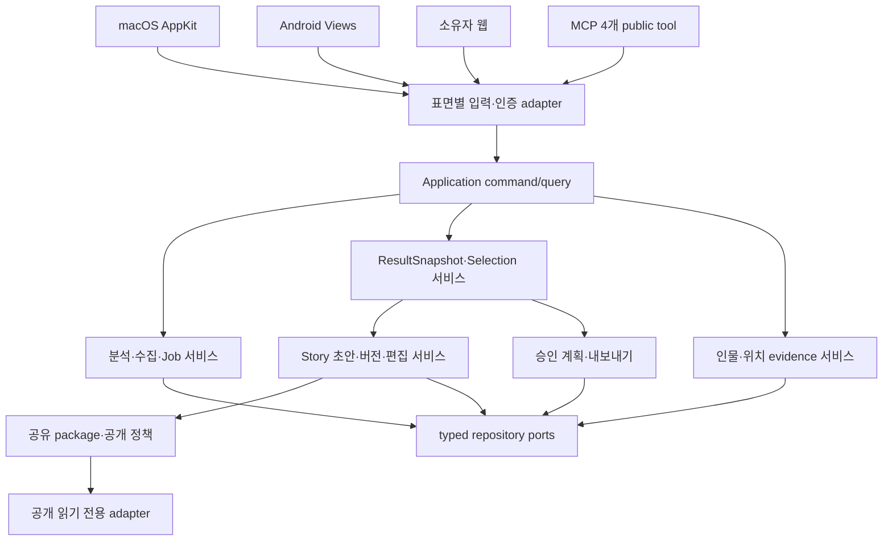

# 제품 구조와 기능 재설계안

> 상태: 감사 기반 제안. 현재 구현 계약을 대체하는 승인된 사양이나 배포 완료 기록이 아니다.
> 작성일: 2026-10-06
> 근거: [구조 감사](01-architecture-audit.md), [UX·기기간 감사](02-ux-cross-device-audit.md), [Story 감사](03-story-audit.md), [설치 앱·문서 관찰](04-live-observations-and-documentation.md)

## 1. 제품의 중심 작업

사용자의 중심 목적을 **사진을 가져와 좋은 사진을 고르고, 검토한 사진으로 이야기를 만들고, 원하는 곳에 보관하거나 공유한다**로 정한다. 서버 상태·모델 평가·파일 원장은 작업을 지원하는 도구다. 홈과 주 탐색을 이 목적에 맞춰 재배치한다.

현재 PyObjC AppKit, Java Android Views, Python 서비스와 공통 Story renderer를 유지하며 기능 단위로 교체한다. SwiftUI·Compose·새 웹 프레임워크로 동시에 전환하면 데이터·작업·기기간 의미 불일치를 해결하기 전에 변경 범위가 커진다. 플랫폼 전환은 이 계획의 선행 조건으로 두지 않는다.

### 제품 표면과 역할

| 표면 | 주요 사용자 작업 | 유지할 고유 역할 | 공유해야 하는 계약 |
| --- | --- | --- | --- |
| macOS 앱 | 소스 선택, 분석, 대량 비교·선택, Story 편집, 저장·관리 | 로컬 폴더·RAW·Apple 보관함, 저장 공간·내보내기 | 작업, 결과, 선택 집합, Story, 조치함, 오류 |
| Android 앱 | 이어보기, 사진 검토, Story 구성·감상, 인물 예외 검토 | MediaStore GPS·outbox·기기 권한·백그라운드 복구 | 동일 객체 ID·revision·scope·상태 |
| 소유자 웹 | Story 목록·감상·간단 편집, 공유 관리 | 안전한 원격 소유자 접속 | 소유자 권한, Story 명령, 동일 presentation |
| 공개 공유 웹 | 지정된 snapshot 감상·허용된 파생 이미지 다운로드 | 만료·passcode·즉시 폐기 | 고정 공유 버전, 허용된 사진·인물·위치 범위 |
| MCP client | 조회·선택·workflow·승인 후 쓰기 자동화 | 기계 판독 가능한 가이드·장기 작업 | UI와 같은 application command/query·정책 |

macOS 폴더 탐색을 Android에 복제하지 않는다. 기능 정합성은 같은 사용자 작업이 같은 사진 집합·상태·승인 의미를 갖는 것이다. 기능을 제공하지 않는 표면은 다른 기기에서 이어 할 수 있는 명확한 안내를 제공한다.

## 2. 공통 객체와 불변 조건

아래 모델은 제안이다. 기존 `StorySourceSnapshot`, manifest, presentation, collection, share package를 재사용하되 누락된 불변 조건을 보강한다.

| 객체 | 제안 필수 필드 | 불변 조건 |
| --- | --- | --- |
| AnalysisRequest | source_refs, date_range/timezone, limit, exclusions, intent, request_id | 논리 요청 최대 10,000장. provider 세션과 사용자 요청을 구별. 재시도는 같은 request_id |
| JobProjection | operation_id, kind, phase, status, processed/total, blocked_reason, next_actions, revision, updated_at | 요청 수락은 완료가 아니다. terminal 상태는 모든 화면에서 동일. 알 수 없음은 완료/빈 결과와 다름 |
| ResultSnapshot | snapshot_id, origin_job_id, ordered_asset_refs, membership_hash, analysis_version, missing_refs | 현재 추천 head를 다시 조회해 다른 사진으로 치환하지 않는다. 작업 결과와 추천 보관소 차이를 명시 |
| SelectionSet | selection_id, result_snapshot_id, ordered_asset_ids, selection_policy, revision | 추천 기본값과 사용자가 고른 사진을 구분. 선택·포커스·사진 필터는 각각 다른 상태 |
| StorySourceSnapshot | source_snapshot_id, result_snapshot_id/collection_ids, ordered_asset_ids, membership_hash, selection_policy | 사진 목록·순서까지 포함한 immutable scope. collection ID만으로 선택 집합을 추정하지 않는다 |
| StoryDraft | story_id, source_snapshot_id, content_revision, chapters, user_edits, generation_state | 날짜 작업/완료 결과/현재 선택이 같은 명령 계층을 통해 초안을 만든다. AI가 사용자 편집을 덮어쓰지 않는다 |
| StoryRevision | revision_id, story_id, parent_revision_id, content_hash, actor_kind, expected_base | append-only 내용 저장. 동일 evidence에서도 제목 변경 저장. 복구는 새 revision, tombstone은 별도 guard |
| StoryOperation/AIAttempt | command_id, story_id, phase/checkpoint, materialization_counts, attempt_status, error, policy_version | 사진 준비·초안 준비·AI 시도 분리. 앱 종료 후 복구, partial을 완전 완료로 표시하지 않음 |
| CaptionClaim | text, claim_kind, evidence_refs/field_paths, confidence, review_state | metadata fact·추정·사용자 메모 구분. 자유 문장을 검증된 사실로 자동 승격하지 않음 |
| StoryPresentation | story_id, presentation_revision, theme_id, renderer_version | 스타일 변경은 분석·소스 사진·서사를 변경하지 않는다. 오래된 공유의 renderer 호환 보존 |
| StoryShare | share_id, story_content_revision, immutable_package, disclosure_policy, expires_at, revoked_at | 공유 생성 시 특정 버전과 공개 범위를 고정. 초안 수정은 기존 공유를 자동 변경하지 않음 |
| StoryReadState | selected_story_id/revision, chapter/item anchor, list cursor, scroll, active facet | device-local 감상 상태. Back·재시도·process recreation에서 현재 Story 유지 |
| StoryExport | exact_revision, format, privacy_policy, asset_manifest/checksum, operation_status | 사진 묶음과 Story 문서 export 구별. 향후 MVP는 offline HTML+파생본+manifest, PDF는 후속 후보 |
| ExportPlan/Receipt | selected_snapshot, destination, count, approval_fingerprint, idempotency_key, receipt | 원본 쓰기·외부 앨범·파일 보관은 승인과 영수증 경로. OS sync root 복사를 cloud 완료로 표시하지 않음 |
| PersonEvidence/LocationEvidence | asset_ref, evidence_kind, confidence, confirmation, disclosure_policy | 정책상 허용한 evidence만 사용. 자동 인물·수동 확인·추정 장소를 구별 |

이름이 같은 인물의 자동 병합은 하지 않는다. 별개 person ID와 alias/relationship label을 유지하고, 충돌하는 confirmed membership을 해결할 검토 흐름을 제공한다. Google 공급자 정책이 금지하는 얼굴 군집·식별은 기기 UI를 바꿔도 우회하지 않는다.

## 3. 공통 서비스와 상태 흐름

표면별 adapter는 인증·서명·입력 파싱·응답 형식만 책임진다. 데이터 접근과 비즈니스 정책은 command/query 서비스에 둔다. 초기에는 SQLite·기존 worker를 유지하고 대형 파일을 기능 소유 모듈로 분리한다. 서비스 분산이나 이벤트 인프라 신설을 전제로 하지 않는다.

### 작업 상태

공통 내부 상태는 `queued → acquiring → analyzing → materializing → building_story → completed/partial`을 기본으로 한다. 범위에 없는 단계는 건너뛴다. `awaiting_user_action`, `waiting_device`, `retry_wait`, `failed`, `canceled`, `interrupted`를 별도 상태로 표현한다. 기존 worker 상태는 adapter가 이 projection으로 매핑하고, 처음부터 내부 저장값을 전부 변경하지 않는다.

사용자 화면에는 대기·사진 가져오는 중·분석 중·이야기 만드는 중·완료·일부 완료·휴대폰 확인 필요·다시 시도 필요 등 작업 언어를 표시한다. 진단 정보는 상세로 이동한다. `partial`에는 성공/실패/제외 장수와 실패분 재시도 행동이 반드시 있다.

구독을 먼저 연결하고 snapshot revision을 확인한다. 새 이벤트를 놓치면 재연결 시 snapshot 전체를 다시 읽는다. 초기 구현은 공통 query와 revision-aware polling으로 충분하며 기존 event 경로를 가능한 곳에서 재사용한다. SSE는 명확한 배터리·수명주기 기준을 만족할 때 채택한다.

### Story 생명주기

Story 편집 상태와 생성 작업 상태를 분리한다. Story는 `draft → reviewed → saved`를 갖고, 공유는 별도 `preparing/active/expired/revoked` 객체다. 자산 준비 전 공개하지 않는다. 생성 실패나 AI 미사용은 결정적 초안을 지우지 않는다. `archived/deleted`는 원본 사진 삭제와 별개이며 late generation·refresh로 tombstone을 해제하지 않는다.

재생성은 `기존 초안 내용 새로 구성`과 `사진 다시 분석`을 구별한다. 후자는 비용·범위·새 버전 생성 여부를 보여준다. 사용자 편집을 새 버전에 어떻게 가져올지는 비교 화면에서 결정한다. 현재 보는 Story와 이전 공유의 내용이 서로 다른 경우 버전 표시를 제공한다.

## 4. 탐색과 화면 설계

### macOS

주 탐색은 **홈 / 사진 / Story / 인물 / 작업**으로 제안한다. 저장 공간과 환경·연결은 관리 영역에 둔다. 기존 항목을 한 번에 없애지 않고 새 이름·redirect·deep link를 유지한다.

| 화면 | 목적·핵심 구성 | 주 행동 | 필요한 상태 |
| --- | --- | --- | --- |
| 홈 | 이어 할 작업, 확인할 사진/인물, 최근 Story·결과 | 이어하기 | 최초 사용, 권한 차단, 조치 필요, 정상, 서버 불가 |
| 사진 시작 | Apple/로컬/Google 소스와 기간·개수·제외 설정 | 범위 확인 | 미선택, 일부 접근 가능, Picker 대기/취소/만료 |
| 분석 확인 | 입력 장수·다운로드·스크린샷 제외·모델 경로 요약 | 분석 시작 | 상한 초과, 일부 소스 불가, 휴대폰 GPS 필요 |
| 결과 workspace | gallery + inspector, 추천/전체/검토, 장면 비교, 현재 선택 | 선택으로 Story 만들기 또는 저장 | 로딩, 빈 결과, 부분 완료, 파일 유실, 선택 없음 |
| Story 라이브러리 | 초안·저장됨·공유중, 기간/인물/검색, 썸네일 | 새 Story | 빈 목록, 로딩, 유실 사진, 접근 불가 |
| Story 구성 | 범위→사진·순서→장면·텍스트→미리보기 | 초안 저장 | 저장 중/됨/실패, 충돌, AI 실패/근거 부족 |
| Story 감상 | 사진·짧은 이야기, 목록 복귀, 보기 설정 | 감상/편집 | 빈/1장/혼합 비율, 사진 로드 실패 |
| 공유 관리 | 공개 사진·인물·위치, 만료·다운로드, version | 공유 생성 | 생성 전 확인, active, expired, revoked |
| 인물 | 예외 큐, 최근 자동 연결, 인물별 사진, 충돌 해결 | 다음 항목 확인 | 로딩, ready-empty, 오류, unknown, conflict |
| 작업 | 같은 operation의 진행·조치·완료 결과 | 필요 조치/결과 열기 | 모든 공통 JobProjection 상태 |

결과 workspace header는 제목·결과 범위·작업 모드를, body는 gallery/inspector를, footer는 현재 선택 장수와 다음 행동을 담당한다. inspector 상단이 header 영역으로 올라오지 않는다. 사진 모드 전환은 선택 집합을 변경하지 않는다. 필터에 숨겨진 선택 장수도 표시한다.

### Android

하단 주 탐색은 **홈 / 사진 / Story / 인물**을 제안하고 작업 상세와 조치함은 홈/진행 배너에서 연다. 네이티브 설정은 별도 진입점에 둔다. 휴대폰 폭에서는 inspector를 상세 화면 또는 bottom sheet로 전환한다. 큰 화면에서는 list/detail 두 pane을 사용할 수 있다.

이는 비교할 후보 IA다. 첫 구현에서는 현재 작업 진입을 유지하고, 인물 탭의 상위 승격은 작업 탭 유지안과 walkthrough로 비교한다. 진행 배너가 없어도 과거 완료/실패/GPS 대기/내보내기 영수증에 접근할 상시 `작업` 링크를 제공한다. 실제 발견성 근거 없이 탭을 제거하지 않는다. Mac 저장 공간의 기존 진입과 deep link도 유지한다.

WebView는 Story 감상 렌더러를 공유하되 인증·뒤로가기·다운로드·연결 실패·초점 인계 계약을 네이티브 wrapper에 명시한다. 편집 command는 동일 backend로 보내며 모바일 전용 임시 HTML form이 별도 정책을 갖지 않게 한다. 브라우저/앱 전환 후 작업 ID·선택·scroll 위치를 복원한다.

### 소유자 웹과 공유 웹

소유자 route에 Story 목록·생성·편집·감상·공유 관리를 구분한다. 공개 route에는 편집·인물 검토·owner API capability가 없다. 소유자 화면을 공개 URL에서 다시 여는 식으로 기능을 이어붙이지 않는다. 공유에서 다운로드가 불가한 경우 이유와 허용된 행동을 설명한다.

## 5. Story 기능 계약

| 기능 | 설계 결정 | 수용 기준 |
| --- | --- | --- |
| 완료 결과→Story | 분석 재실행 없이 선택된 snapshot으로 생성 | 새 vision/ranking job 시작 0, 완료 결과 read 허용, Mac/Android ordered asset 집합·hash 일치 |
| 날짜→Story | 기간·timezone·출처·limit·제외·GPS 필요를 미리 확인 | 승인한 날짜·출처 범위만 수집, 실패·대기 원인 표시 |
| 사진 고르기 | 추천/현재 선택/전체 범위 명시 | 필터 변경·기기 이동·재시작에도 선택 의미 불변 |
| 사진 순서/장면 | 드래그와 버튼·키보드 대안, 장면 합치기/나누기 | 순서가 모든 테마·공유 snapshot에 결정적으로 반영 |
| 제목·이야기 | evidence 기반 초안, 사용자 수정 우선 | 인물·장소·시점이 evidence와 연결되며 모르는 사실은 생성하지 않음 |
| 테마 | 현행 5개 정의를 capability/renderer registry로 관리 | 초안·출처 불변, 현재/레거시 제공 상태가 문서와 UI에서 일치 |
| 사진 오류 | 타일별 재시도, 실패 수·대체 이미지 | 한 장 오류가 전체 감상을 막지 않으며 다른 자산으로 조용히 대체하지 않음 |
| 초안 저장 | content_revision 기반 optimistic concurrency | 중복 요청은 한 revision, 충돌은 reload/비교, 사용자 수정 손실 0 |
| 재분석 | 기존 snapshot 유지, 새 analysis/result version 생성 | 이전 Story·공유·선택을 조용히 변경하지 않음 |
| 삭제 | Story 기록·파생물·공유·원본의 영향 분리 | 원본 사진 삭제 0, 공유 폐기와 artifact 회수 결과 설명 |
| 공유 | 특정 reviewed/saved revision으로 immutable package | 공개 preview와 실제 package 사진·이름·위치 동일, 만료·폐기 즉시 차단 |

Story의 가치 판단 기준은 테마 숫자가 아니라 선택과 편집이 의도대로 보존되고, 사진과 설명이 근거를 갖고, 같은 이야기를 기기마다 이해하고 감상할 수 있는지다. 5종 테마 자체는 현행 코드에서 제공되므로 임의로 2종으로 축소하지 않는다. 성능·사용성 측정 후 기본 노출 순서와 고급 테마 노출 방식을 결정한다.

## 6. API·오류·안전 계약

새 application command 제안은 `CreateStoryFromResult`, `CreateStoryFromSelection`, `PreviewDateStory`, `UpdateStoryDraft`, `RebuildStoryContent`, `ReanalyzeStorySource`, `CreateShare`, `RevokeShare`, `PlanExport`, `ResolvePersonConflict`다. HTTP route 이름은 기능 spec 단계에서 기존 route 호환성 표를 보고 확정한다. MCP public tool 4개는 유지하고 action 추가는 registry·도구 참조·계약 테스트를 함께 수정한다.

Story 상세의 공유·내용 재구성은 story_id/expected_revision을 필수로 받으며 latest fallback을 금지한다. 생성 완료 후에도 응답의 story_id를 직접 연다. 현재 코드에서 상세의 공유 대상이 최신 Story로 바뀔 수 있는 STORY-01은 편집·테마 확장 전에 예방 수정한다.

승인은 plan→신뢰된 owner decision→execute를 유지한다. 일반 MCP agent는 자신의 계획을 자동 승인할 수 없다. 중앙 executor는 verified approval/정확 대상/claim/시작 receipt를 검증·원자 기록하고, 외부 write가 불확실하면 reconcile_required로 남긴다. 무효 요청을 기본 Apple 범위로, 잘못된 privacy enum을 remote_allowed로 바꾸지 않는다. health는 인증 없는 최소 status/count, 상세 token·개인 경로는 owner 진단으로 제한한다.

이름·위치 변경과 공유 폐기는 UI list limit를 전수 처리 limit로 쓰지 않는다. affected-resource index/cursor·SQL condition·outbox와 consent epoch를 사용하고 실제 처리 수를 대조한다. 큰 repository 파일 분리는 승인 transaction·worker lifecycle·복구 경계를 고정한 뒤 수행한다.

Mutation 응답은 `operation_id`, `status`, `resource_id`, `revision`, `next_actions`, `error`를 포함한다. 오류는 `code`, 사용자 메시지, 재시도 가능 여부, 해결 행동, 진단 ID로 나눈다. raw exception·절대 개인 경로·키는 일반 UI에 표시하지 않는다. 목록 읽기 실패 시 `[]` 또는 count 0으로 바꾸지 않고 stale/unknown을 명시한다.

정확 위치 공유에 대한 기존 가족 사용 정책은 자동으로 축소하지 않는다. 각 공유 전에 공개할 정확 GPS/POI·확정 이름·다운로드 범위를 보여주고 기존 동의 정책을 적용한다. 소유자에게 제공되는 정보와 공개 package에 들어가는 정보를 동일 DTO로 무조건 재사용하지 않는다. 스크린샷 제외는 분석 전 필터와 결과 측 방어를 유지한다.

모델 송신은 이미지/VLM, Story evidence, Maps GPS, Google 업로드 등 전송 종류별로 구분한다. Story 전체 refs를 모델이 반환하도록 맡기지 않고 서버가 coverage·순서를 확정한다. AI는 장면별 제한 evidence로 prose를 제안하며 unknown 이름·관계·장소·감정은 사실 확정에서 제외한다. 지도 iframe의 third-party src는 설명된 사용자 행동 뒤에 설정하는 계약을 검증한다. 기존 detailed share의 공개 정책을 변경하려면 새 공유 발행·폐기를 명시한다.

## 7. 스킬 적용과 공식 기준

| 적용 스킬 | 이 설계에 적용한 판단 | 확인 방법 |
| --- | --- | --- |
| ux-heuristics | 상태 가시성, 사용자 언어, 되돌리기·오류 복구, 기기간 일관성, 다음 행동 발견성 | LIVE-01/04/05, 작업→결과→초안→공유 walkthrough |
| refactoring-ui | 한 화면 한 주 행동, header/body/footer 위계, 고정 토큰·이미지 비율·가독성 | bounds 교차 검사, grayscale/blur 검토, 대비 측정 |
| swift-macos | AppKit 창·menu·panel 역할, 기본 키보드·AX·창 수명주기 | 설치 bundle 실제 화면·VoiceOver·resize |
| mobile-android-design | 큰 터치 영역, 상태 hoisting, 대량 목록·adaptive layout, 이동 후 상태 보존 | Android Views에서 동등 원칙 적용, TalkBack·회전·process death |

웹은 WCAG 2.2 AA를 기준으로 keyboard·focus·target·대비·reflow를 확인한다. WCAG 2.5.8의 최소 크기 기준은 예외 조건을 포함해 24 CSS px이며, 제품의 기본 모바일 행동은 44–48 CSS px 목표로 설계한다. Android 네이티브는 최소 48×48dp 조작 영역을 목표로 한다. px·pt·dp를 하나의 단위처럼 다루지 않는다.

공식 근거(2026-10-06 확인): [W3C Target Size](https://www.w3.org/WAI/WCAG22/Understanding/target-size-minimum.html), [W3C Focus Not Obscured](https://www.w3.org/WAI/WCAG22/Understanding/focus-not-obscured-minimum.html), [Android 접근성](https://developer.android.com/guide/topics/ui/accessibility/apps), [Android WebView](https://developer.android.com/develop/ui/views/layout/webapps/webview), [Apple Navigation and Search](https://developer.apple.com/design/human-interface-guidelines/navigation-and-search). Apple 페이지는 이번 도구로 본문이 충분히 추출되지 않아 세부 수치·특정 배치의 의무 근거로 사용하지 않았다.

## 8. 결정할 항목과 제안 기본값

편집 첫 MVP는 기존 scope 안의 제목·짧은 글·사진 제외·순서, **명시 저장**, revision 충돌·이전 버전 복구로 제한한다. 사진 추가/source expansion·장면 분할/병합·자동저장·오프라인 초안·AI 재구성은 후속 확장이다. 초기 `저장 중/저장됨/실패/미저장` 행동과 창 닫기·Back의 입력 보존을 먼저 확정한다. reviewed는 사용자가 공개할 내용을 확인한 상태이며 generation ready와 같지 않다. 기존 Story는 `legacy_saved`로 읽고 자동 AI 실행/강제 재검토/재분석 없이 기존 감상·공유를 보존한다.

| 항목 | 제안 기본값 | 구현 전 확인 |
| --- | --- | --- |
| 모바일 편집 범위 | 사진 추가·제외·순서·제목/짧은 글, 상세 장면 구성은 Mac 우선 | 양쪽에서 필요한 실제 작업을 5명 이하 소규모 walkthrough로 확인 |
| 대량 Story 감상 | pagination/virtualization로 viewport 주변만 mount | 10,000장 fixture의 렌더·메모리·접근성 기준 |
| 외부 공유 | 기존 만료·인물 동의·다운로드 정책 유지, 생성 전 preview 강화 | 실제 가족 공유의 필요한 위치 정밀도 |
| 구조 개선 | 기존 application 서비스와 DB를 기능별 repository port로 점진 분리 | 이중 쓰기 기간 최소화, 기존 schema backup/replay |
| 성공 지표 | 선택→Story 생성 완료율, stale 상태 0, 기기간 scope 불일치 0 | baseline과 실제 사용 표본을 먼저 측정 |

현재 설계에서 확정하지 않은 것은 위의 사용 범위와 측정 예산이다. 이 항목을 정하지 않았다는 이유로 상태·bounds·오류·snapshot 보존 문제의 수정을 지연할 필요는 없다.
