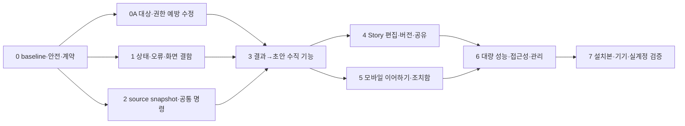

# 개선 작업 순서와 검증 계획

> 상태: 구현 착수 전 검토안. 제품 코드·schema·배포 변경은 이번 조사에서 실행하지 않았다.
> 작성일: 2026-10-06
> 설계 기준: [제품·기능 설계](05-product-and-feature-design.md)
> 발견 목록: [구조](01-architecture-audit.md), [UX·기기간](02-ux-cross-device-audit.md), [Story](03-story-audit.md), [실제 화면·문서](04-live-observations-and-documentation.md)

## 1. 우선순위와 착수 방식

P0는 데이터·권한·공개 범위·승인 경계가 깨지는 문제, P1은 주요 작업 차단·잘못된 상태·선택 손실·기기간 의미 불일치, P2는 발견성·편집 품질·성능·접근성 보강, P3는 추가 시각 완성도로 정한다. P0/P1은 디자인 취향이나 코드 줄 수로 결정하지 않는다.

아래 단계는 순서만으로 끝내지 않는다. 각 단계의 gate가 통과해야 다음 의존 단계로 진행한다. 기간은 실제 task 분해와 기기 baseline 확인 후 산정한다. 이번 문서의 gate·수치는 **제안 수용 기준**이며 측정 완료 실적이 아니다.

## 2. 단계별 작업

### 단계 0 — baseline과 계약을 고정한다

**담당:** 통합/QA + 각 영역 담당. **선행:** 없음.

1. 조사 시작부터 있던 `people/controller.py` 변경을 diff로 확인해 구현 의도와 소유자를 기록한다. 이를 되돌리거나 감사 수정과 섞지 않는다.
2. 체크아웃 commit, 설치 Mac bundle, Android package/version/signing, owner/private/public endpoint 구성을 비밀값 없이 기록한다. 설치본과 소스가 다르면 결함을 각각 재현한다.
3. 기능 목록에 `implemented`, `reachable`, `deployed`, `verified`, `remaining_gate`를 나누어 기록한다. 과거 로드맵의 완료/대기 표현을 현행 계약과 분리한다.
4. 개인 데이터 없는 0/1/12/100/1,000/10,000장 fixture, 혼합 source, 극단 비율 사진, 중복 인물 이름·confirmed membership conflict, 유실 파일, 부분 실패, stale job 상태 fixture를 만든다.
5. 기존 DB/schema와 migration 목록, 승인 token·영수증·share snapshot·GPS ledger 보존 전략을 기록한다. 스키마 변경은 test DB migration rehearsal을 먼저 수행한다.

**수용 gate G0:** 원본/키/클라우드에 쓰지 않고 재현 가능한 baseline 확보. 각 source의 허용·금지 capability와 surface 권한 표 완성. 기존 계약 테스트의 pass/fail 분류. 문서 coverage 표에서 미검증 항목 누락 0.

### 단계 0A — 외부 대상과 권한 경계의 예방 수정을 선행한다

**담당:** owner HTTP/Story + 승인/정책/운영. **선행:** G0. 단계 1~2 및 새 기능 배포보다 우선한다. 다음 구현 단계에서 수행하며 이번 조사로 운영 설정을 변경하지 않는다.

| 작업 | 연결 발견 | 최소 예방 수정 | gate G0A |
| --- | --- | --- | --- |
| T0A.1 정확한 공유 대상 | STORY-01/02/20 | 공유·재구성 command에 story_id와 expected revision 요구. 누락 시 reject, latest fallback 금지. 완료도 반환 story_id로 직접 연다. | A 상세에서 B를 나중 갱신해도 A만 대상. 삭제·revision 충돌·missing ID면 package/AI 호출 0 |
| T0A.2 공개 폐기·삭제 보장 | STORY-07/08/09 | tombstone guard, 부모 삭제/consent epoch의 public 접근 검사, 전수 cursor 또는 SQL 조건 revoke·실패 outbox. UI pagination과 전수 처리 분리. | 201/1,001 Story와 501+ share에서 누락 0. 삭제 후 late response/refresh 복원 금지. 철회 뒤 기존 session/asset 접근 차단 |
| T0A.3 엄격한 요청·privacy 설정 | ARCHITECTURE-02/14 | 무효 options는 오류, 모르는 privacy enum은 실행 금지. VLM·Maps·Story director·업로드 정책 범위 각각 명시. | invalid JSON/array/enum/날짜 역전에서 기본 source 분석 0. 잘못된 local-only에서 network stub 호출 0 |
| T0A.4 최소 health·proxy 신뢰 | ARCHITECTURE-12/13 | health는 count/status만. 상세 계획·token은 인증 진단으로 이동. listener host를 요청 인증 대용으로 쓰지 않음. 실제 route exposure는 read-only 확인. | sentinel token/path/사진 ID health 출력 0, trusted proxy allowlist·인증 negative test 통과 |
| T0A.5 승인 실행·복구 | ARCHITECTURE-03/04/08/09 | plan→trusted owner decision→execute 명시, 중앙 executor 검증. 승인 claim과 시작 receipt를 같은 DB transaction으로 기록. 불확실 외부 쓰기는 목적지별 reconcile 후 재시도. | 직접/복구 caller 승인 우회 0. claim 직후 crash에서 이중 쓰기 0 또는 명시 reconcile_required. agent 자기 승인 금지 |
| T0A.6 잘못된 workflow 약속 | ARCHITECTURE-05 | import-then-curate가 import만 하는 현재 alias를 deprecated/blocked하거나 실제 순서 설계. 옵션을 버리고 다른 명령으로 실행하지 않음. | fake writer에 승인된 exact 대상·의도만 전달, selection 설정 누락/unknown option 거절 |

G0A는 예방적 수정 우선순위다. 실제 잘못된 공개 공유·외부 노출 사고가 발생했다고 단정하지 않는다. 임시 gate를 넣으면 사용자 메시지·영향 범위·해제 테스트를 제공한다.

**개발/배포 의존:** G0 이후 상태·bounds·AX·대비의 격리 개발/fixture 검증과 T2 계약 준비는 병행할 수 있다. 외부 공유·원격 실행·쓰기 경로의 통합/배포와 G3 활성화는 G0A 통과 뒤다. missing Story ID는 대상 목록 재선택, revision conflict는 새 버전 비교/재확인, deleted는 목록 복귀, invalid options는 필드별 수정 안내를 제공한다. 기존 입력·선택·결과 읽기를 유지하고 latest 자동 대체로 차단을 풀지 않는다.

### 단계 1 — 잘못된 상태와 실제 화면 결함을 먼저 고친다

**담당:** AppKit/UX, 공통 상태 projection. **선행:** G0. 배포 전 G0A 통과.

| 작업 | 변경 대상 | 구체 구현 | 검증 |
| --- | --- | --- | --- |
| T1.1 분류 terminal 복귀 | `interfaces/appkit/classification/controller.py`, `main/controller.py` | accepted job_id 바인딩, 공통 상태 조회/구독, terminal에서 버튼·문구·AX 동시 갱신 | 수락→완료/실패/취소 후 tab 왕복, 앱 재시작. 작업 목록과 상태 일치 |
| T1.2 결과 bounds | `interfaces/appkit/results/controller.py`와 순수 layout helper | header/body/footer 영역 분리, inspector 높이를 body rect로 제한 | 최소·기본·전체 화면, resize 없이 초기 데이터 로드, 모든 interactive bounds 교집합·가림 검사 |
| T1.3 인물 오류 | `interfaces/appkit/people/controller.py`, identity 서비스 오류 projection | loading/empty/stale/error/conflict 구분, 사용자 해결 행동, raw exception 제거 | 오류 시 완료 카드 금지, confirmed collision fixture, 다시 시도와 입력 보존 |
| T1.4 Story route·안내 | AppKit Story shell, owner renderer/route | 목록/감상 구분과 목록 복귀, 실제 route에 맞는 제목·다음 행동 | 이전 상세 재진입, viewer/뒤로가기, WebView reload, 실패 복구 |
| T1.5 접근성 문구 | shared view model/AX 적용 경로 | title/description/help/value 공통 계산 | source/limit/intent/state 변경별 AX와 렌더 일치 |
| T1.6 대비·고정 정상 상태 | AppKit home/jobs와 Story CSS token | 서버 badge는 실제 상태로 파생. 다크 primary의 on-accent 색을 theme별 정의 | 서버 중지/unknown fixture에서 정상 금지. light/dark 활성·focus·disabled 대비 측정, UX-28의 1.21:1 반례 해소 |

**수용 gate G1:** LIVE-01~05 같은 시나리오를 설치 앱에서 다시 검증. 상태 불일치·header overlap·오류를 빈 큐로 표시하는 경우 0. 자동 controller 테스트 통과만으로 이 gate를 닫지 않는다.

G1에는 T1.6의 light/dark 활성 버튼 대비와 실제 서버 상태, 변경된 화면의 keyboard-only·AX label/value/focus smoke를 포함한다. UX-28의 1.21:1 반례를 우선 교정하고 normal text 4.5:1/large text 3:1 목표를 확인한다. 보조기술 전체 coverage는 G6에서 확장하되, 변경한 주 행동이 키보드·보조기술에서 접근 불가하면 G1을 닫지 않는다.

### 단계 2 — 선택 범위와 command/query 계약을 고정한다

**담당:** application/domain/persistence/MCP. **선행:** G0. T1과 disjoint write set이면 병렬 가능.

| 작업 | 변경 대상 | 구체 구현 | 검증 |
| --- | --- | --- | --- |
| T2.1 snapshot 보강 | `application/result_story_service.py`, `recommendation_storage.py`, repository | ordered asset membership·selection policy·원본 결과 version/hash 고정, explicit selection API | 서로 다른 선택 A/B가 다른 snapshot, 재시도 동일 hash/Story, 변경된 current-head가 snapshot을 바꾸지 않음 |
| T2.2 공통 Story command | result/manual Story 서비스와 facade, owner/mobile route | 표면별 검증·인가 adapter 뒤 동일 command 호출, scope/limit/GPS/재분석 정책 통합 | 동일 입력을 Mac/owner/Android/MCP에서 실행한 계약 결과 비교 |
| T2.3 typed repository 경계 | 대형 repository와 application service | Story/result/job/identity/export port 분리, composition root 주입 | import dependency + transaction failure rollback + fake port contract |
| T2.4 Job/error DTO | 공통 application query·state projection | operation kind/phase/status/next_actions/revision, partial와 unknown | provider 부분 실패·대기·재시작·stale 상태별 surface parity |
| T2.5 승인·idempotency 정합 | mutation service, route guards, facade | command에서 정책 강제, 중복·인가·scope 변경을 동일하게 처리 | 모든 쓰기 진입의 negative tests. 승인 대상 변경 후 이전 token 거절 |
| T2.6 worker 생명주기 | `app/lifecycle.py`, MCP/mobile factory·lifespan, ranker queue | runtime owner 1개, embedded/standalone 동일 startup/shutdown, drain/cancel/await/checkpoint/join 확인. deferred 상태를 terminal/조치로 투영 | long blocker·cancel·2회 restart·startup requeue. thread 생존 시 stopped 금지, dispatcher 호출 정확히 1회 |
| T2.7 인물 충돌·계보 | identity repository/검토 command/UI projection | 같은 이름 별개 ID 구분 단서, owner-confirmed 보존, revision/CAS·lineage·undo·Story 갱신 outbox | 같은 이름 자동 병합 0, concurrent decision conflict, 실패 항목 재시도·기존 확정 연결 보존 |
| T2.8 최소 버전·내구 저장 | result/Story repository·operation coordinator | insert-only source membership, content revision/CAS·tombstone·생성 checkpoint를 G3 전에 확정. 기존 curation queue/claim 재사용. 결과 read API와 새 분석 시작을 구별 | 선택 A/B·동시 생성/수정·중간 kill에서 이전 snapshot/revision 유지. 새 vision/ranking job 시작 0, 결과 조회는 허용. AI attempt는 명시 모드만 실행 |
| T2.9 최소 navigation·권한 복귀 | native route state·WebView wrapper·mobile projection | destination stack, selected Story/revision/result ID, query/cursor/scroll, selection/draft revision, operation ID 보존. pairing·부분 권한/승인 뒤 명시 계속을 기존 등록 경로 위에서 먼저 연결 | 결과→초안→Back은 원래 결과/선택. viewer→본문→목록. TTL/인증 실패는 재조회·재인증, pending mutation 자동 실행 0. Android 실제 기기 검증은 not_run/별도 G5 |
| T2.10 export 재개·빈 상태 | job/error query·receipt·Mac/mobile UI | 사진 export receipt/partial을 상시 작업 목록에서 열고 남은 대상 재개. 0장/삭제/404/권한/네트워크/unknown을 분리 | 배너 없이 실패 export 찾기·정확 remaining set 재승인, 사진 불가를 추천 없음으로 표시 금지 |

**수용 gate G2:** 선택 집합·순서·source evidence가 immutable하고, 모든 대상 표면에서 같은 입력의 정책 결과가 같다. Google provider 제약·기기 서명·share read-only·원본 보존 회귀 0. 포트 분리는 line count 감소가 아니라 구체 정책 중복 제거로 평가한다.

G2에서 최소 append-only revision·CAS·operation checkpoint를 고정한다. 전체 편집·버전 비교 UI는 단계4에 둔다. 기존 `StorySourceSnapshot`/manifest/presentation/curation/approval/receipt/GPS/identity 원장과 새 객체의 field 매핑·상태 alias·schema version을 task spec에 넣는다. provider/account/grant/lease/expiry와 origin provenance를 잃지 않는다. 전체 DB 또는 모든 port를 동시에 재구축하지 않는다.

G0의 재사용 매핑 산출물은 `제안 개념→현행 서비스/schema/field→유지/alias/필드 보강/신설→호환 caller→검증` 표다. result_story_service·selection persistence·export resume·mutation receipt·mobile curation을 우선 재사용하고 동일 선택의 권위를 두 저장소로 갈라놓지 않는다. 신설은 제목/본문 history 등 실제 공백으로 제한한다. port 전체 분리 완료를 T1 또는 작은 CTA 개선의 불필요한 선행 대공사로 만들지 않는다.

### 단계 3 — 완료 결과→Story 초안을 하나의 기능으로 완성한다

**담당:** 결과 UI + Story UI + mobile integration. **선행:** G0A/G1/G2. 최소 내구 저장·worker 소유권·CAS를 먼저 완료한다.

**T3.0 탐색/첫 실행 수직 시안:** 홈의 이어하기·사진 범위·결과·Story 목록/감상 route를 fixture로 시안화한다. 기존 탐색·deep link redirect와 원래 작업 복귀를 유지한다. 0장/권한 차단/GPS 대기/오류를 포함한 walkthrough 후 IA를 확정한다. 전체 navigation 교체를 이 단계의 선행 조건으로 두지 않는다.

1. 결과 footer에 현재 선택 장수·숨겨진 선택·추천 기본값을 보여준다. `내 선택으로 Story 만들기`와 `추천 사진으로 Story 만들기`의 실제 policy를 구별한다.
2. scope 확인 화면에서 출처·기간·사진 장수·제외 사유·부분 materialization 여부를 설명한다. 0장·누락 사진·기기 GPS 미도착·1장에서도 다음 행동을 제공한다.
3. ranker를 재호출하지 않고 관리 자산을 materialize하고 결정적 초안을 만든다. AI 서사 보강이 느리거나 실패하면 감상 가능한 초안과 현재 생성 상태를 먼저 표시한다.
4. 생성된 동일 story_id/content_revision/source_snapshot을 Android와 소유자 웹에서 연다. 원래 결과로 돌아가 선택을 수정하면 새 초안/새 source version 관계를 설명한다.

**수용 gate G3:** fixture 12장에서 3장을 명시 선택했을 때 모든 표면에서 같은 3장·같은 순서·같은 hash. 테마 변경 후에도 일치. 새 vision/ranking 분석 job 시작 0(완료 결과 read API는 허용), 중복 command로 초안 중복 생성 0. optional Story AI는 명시 모드의 독립 attempt만 허용. 실패 후 선택 손실 0. copy/snapshot/draft checkpoint 직후 종료·복구를 확인한다. 각 변경 bundle의 설치 Mac acceptance와 synthetic WebView walkthrough를 수행하며 Android 기기 미연결이면 G5 실기기 gate를 남긴다.

### 단계 4 — Story를 편집 가능한 버전 객체로 만든다

**담당:** Story domain/UI/share. **선행:** G3.

**G4a 편집 MVP / G4b 확장 분리:** 먼저 기존 scope의 제목·짧은 글·사진 제외·순서, 명시 저장, CAS 충돌·이전 revision 복구를 구현·검증한다. 그 뒤 사진 추가/source expansion·장면 합치기/나누기·자동저장/오프라인 draft·AI 재구성으로 확장한다. legacy Story는 legacy_saved로 읽고 자동 재생성/강제 재검토 없이 기존 감상·공유를 보존한다. 공개 대상·폐기·tombstone guard는 어느 MVP 유예에도 후퇴하지 않는다.

1. 사진 추가·제외·순서, 장면 합치기/나누기, 제목·짧은 글, 초안 자동 저장을 구현한다. gesture와 동등한 버튼·키보드 대안을 제공한다.
2. content_revision과 presentation_revision을 분리한다. user edit patch와 AI/generated field를 나누고 conflict를 비교·복구한다.
3. Story scope를 다시 분석하는 명령과 이야기 내용만 다시 구성하는 명령을 분리한다. 기존 버전·공유는 유지하고 새 버전으로 검토한다.
4. Story 삭제, history 정리, cache 삭제, 추천 보관 제거, provider 앨범 쓰기의 영향을 분리한다. 실제 바이트 회수는 공유·다른 Story 참조를 확인한다.
5. 공유 생성은 공개 preview와 immutable package를 검증한다. 확정 이름·정확 위치·download policy·만료를 확인하고 공개 adapter에서 재강제한다.

6. 생성은 durable operation/checkpoint로 옮기고 narrative 준비·materialization 완전성·AI attempt를 분리한다. AI 재시도는 사진 복사를 반복하지 않는다. 삭제 tombstone은 generation upsert보다 우선한다.
7. 서버가 ordered refs/coverage를 확정하고 모델에는 제한 장면 evidence와 짧은 prose만 요청한다. 10,000장 refs를 1,800 token 응답에 맡기지 않는다. unknown claim·철회 이름·민감 원문 송신을 fixture로 차단한다.
8. 공유는 preparing→active로 전환한다. 허용 자산 준비와 immutable package 검증 후에만 공개한다. process crash/partial image failure에서 active 잔존을 만들지 않는다.
9. Story export는 사진 묶음 export와 별도 backlog로 정의한다. 첫 후보는 exact revision의 offline HTML+허용 파생본+manifest/checksum이며 개인 경로·키·공개하지 않은 evidence를 제거한다. 사진 export 승인 경로를 재사용하고 Story·공유 상태를 변경하지 않는다. G4의 필수 편집/공유 수정과 분리해 후속 MVP로 시행할 수 있다.

**수용 gate G4:** 생성·수정·충돌·재생성·재분석·삭제·공유 만료/폐기의 전체 lifecycle 테스트. 사용자 편집 덮어쓰기 0. private evidence의 미승인 공개 0. 한 장 오류로 전체 viewer 차단 0. 기존 5종 테마·레거시 share 호환 유지. 같은 근거의 제목 변경 저장·이전 revision 복구, 요청 N/포함 M/실패 K와 사실 검토 상태를 확인한다. 단계 종료별 kill/restart와 preparing share의 public 차단을 확인한다.

### 단계 5 — 모바일 이어하기와 조치함을 정합화한다

**담당:** Android + mobile BFF + 공통 job projection. **선행:** G3.

**T5.0 기기간 역할 시안:** 홈·사진·Story·인물의 native 탐색과 공통 operation/detail을 fixture로 검토한다. 현재 화면을 전부 복제하지 않고 같은 객체 의미를 맞춘다. 마지막 기능은 T5.1~7이다.

후보 IA는 기존 작업 탭 유지안과 비교한다. 배너 없는 완료/실패·GPS 대기·export receipt·인물 검토를 찾는 task completion/잘못된 진입/복귀 경로를 기록한다. 상시 작업 링크·기존 route redirect를 유지한 뒤 결과로 탭 이동을 결정한다. T5.7의 최초 pairing/권한 복귀 최소 계약은 T2.9에서 앞당기고 새 간편 등록/확장 UX는 단계5에 둔다.

1. MainActivity의 기능 책임을 home/results/story/people/settings controller 또는 ViewModel 성격의 모듈로 분리한다. Java Views를 유지하면서 수명주기와 비즈니스 상태를 Activity에서 분리한다.
2. 결과 snapshot 기준으로 목록·선택·pagination을 연결한다. current Story의 추천만 보여주는 projection은 별도 이름으로 표시한다.
3. 네트워크 단절·rotation·process death·앱/브라우저 왕복에서 scope/선택/작업 ID를 복구한다. 인증이 끝나도 pending command를 자동으로 중복 실행하지 않는다.
4. 결과 알림과 사용자가 조치해야 할 GPS/Picker/권한 알림을 나눈다. 읽음/조치완료/실패 상태를 구분하고 Mac에서도 같은 조치를 조회한다.
5. WebView URL 허용 목록, owner token/cookie 범위, history와 네이티브 back, 외부 링크·download 인계를 명시한다. 실패 화면에는 재연결과 마지막 정상 화면 복귀를 제공한다.
6. origin_run_id만으로 manual을 추정하지 않고 origin_kind와 can_reanalyze_source/can_regenerate_text/can_edit/can_share를 서버가 제공한다. 재시도는 selected_story_id를 유지한다. 20/50개 목록 상한은 cursor/search로 대체한다.
7. pairing·연결·권한을 별도 단계로 만든다. 등록 JSON/ADB 입력은 고급 진단에 남기고 일상 사용은 신뢰된 등록/QR 등 안전한 handoff를 설계한다. 읽기와 GPS 권한은 별개 capability, GPS 미허용이어도 가능한 감상을 제공한다. OAuth 설정은 Mac 관리 흐름으로 안내하며 원래 pending task를 보존한다. 권한·credential·등록 변경은 해당 구현의 명시 범위를 따른다.

**수용 gate G5:** 등록 Android 기기에서 같은 Story·result hash 확인. 오프라인/재연결/회전/process death 후 선택·작업 의미 손실 0. GPS outbox·서명·replay/idempotency 회귀 0. 공개 공유 URL이 owner 제어 capability를 얻는 경우 0.

### 단계 6 — 대량 성능·접근성·관리 화면을 검증한다

**담당:** 공통 renderer/Android/AppKit/QA. **선행:** G4/G5.

| 영역 | 제안 수용 기준 | 방법 |
| --- | --- | --- |
| 10,000장 처리 | 논리 job 1개·provider session 분리, checkpoint·partial 복구, 누락/중복 계산 일치 | deterministic provider fake와 100장 checkpoint 실패 주입 |
| 대량 목록 | 네이티브 cell 재사용, 웹 전체 10,000장 DOM 상시 mount 금지, bounded image cache | 0/1/100/1,000/10,000 fixture; mounted 노드·heap·메모리 추이 측정 |
| 반응성 | 개발 baseline에서 100/1,000/10,000장 스크롤·필터·다음 사진 측정 후 예산 확정 | 동일 Mac/Android reference 기기에서 median/p95·메모리·네트워크 측정. 미측정 고정 SLA를 주장하지 않음 |
| 폭·글꼴 | Web 320/390/768/1440 폭·200% 확대, Mac 최소/기본/전체, Android font scale 1.0/1.3/2.0 | horizontal overflow·잘림·overlap·초점 가림 검사 |
| 사진 형태 | 가로/세로/정사각/파노라마/극단 비율·metadata 없음·broken image | contain 감상·안전한 crop 목록·재시도·aria 대안 |
| 입력·접근성 | keyboard/VoiceOver/TalkBack, visible focus, touch target, reduced motion, 대비 | axe 자동 + 실제 보조기술 task 수행. 0 violation을 전체 준수로 과장하지 않음 |
| 저장 관리 | 참조량/고유량/캐시/회수 가능량 분리, 전체 Story 접근 | shared asset fixture의 union 계산·삭제 영향 preview·영수증 |
| 문서 | code/deployed/verified 구별, Story/Android/endpoint 안내, 현재 registry 경로 | docs validator, action contract, 링크 도달성 |

원장 연결용 작업 ID: **T6.1** 대량 목록·checkpoint, **T6.2** 폭·글꼴·시각 토큰/대비, **T6.3** 입력·접근성/지도 네트워크 계약, **T6.7** 저장 관리·asset availability, **T6.8** 문서·인덱스, **T6.9** 사진/Story/인물 검색·cursor 목록. T6.9는 source 권한 범위 내 검색하며 현재 폴더 검색과 통합 저장소 검색 범위를 구별한다. 다른 번호는 예약하지 않으며 이 표에 없는 task를 실행했다고 취급하지 않는다.

**수용 gate G6:** 지원 범위의 필수 gate 미통과를 완료로 처리하지 않고 결과·한계를 reports에 기록한다. 미연결 기기·실계정·보조기술 등 미검증은 담당·완료 증거·후속 단계로 남긴다. 대량 performance budget과 기준 기기를 명시. 비밀·실명·개인 사진을 fixture/report에 복제하지 않는다.

### 단계 7 — 운영과 동일한 사용자 경로를 검증한다

**담당:** 통합/배포/실기기 QA. **선행:** G6.

새 bundle/APK는 격리된 build output에서 검사한다. 설치와 실제 계정 변경은 해당 구현 작업의 권한 범위에 맞춰 진행한다. 검증 순서는 소스 계약→fixture UI→packaging smoke→설치본 UI→등록 기기→필요한 실계정·공유 만료/폐기다.

**수용 gate G7:** 새 Mac bundle·Android APK가 동일 데이터/Story revision을 사용하고, 앱 재시작·daemon 재시작·기기 단절/복구 후 새 작업이 end-to-end 완료. 배포 revision·회귀 결과·migration·rollback 경로를 최종 reports에 기록. health 응답만으로 완료 처리하지 않는다.

## 3. 테스트 전략과 이번 확인된 baseline

이번 부모가 직접 실행한 기존 테스트 결과:

- Story·result snapshot·mobile·MCP action 문서·AppKit menu 관련 **194개 통과** (6.95초).
- architecture·mutation approval·recommendation lifecycle·storage insights·source contract 관련 **43개 통과** (1.29초).

이는 기존 계약의 baseline이며 새로운 설계 구현이나 설치 화면 결함 해결을 증명하지 않는다. 새 테스트는 정책 중복, scope 손실, transaction interruption, stale 상태, 실제 bounds 등 변경이 실패할 수 있는 경계에 집중한다. 코드의 문구를 그대로 비교하는 테스트만 늘리지 않는다.

### 필수 negative/복구 시나리오

| 시나리오 | 보존할 항목 | 기대 동작 |
| --- | --- | --- |
| 요청 두 번 클릭/네트워크 재전송 | request_id/selection | 한 operation·한 snapshot, 결과 조회 |
| 가져오기 3/5 provider session 후 중단 | acquired membership/checkpoint | 이미 받은 사진 보존, 누락분만 재개 |
| 분석 완료 후 UI tab 복귀 | job_id/result | 완료 상태·결과 열기, 새 분석 가능 |
| materialization 일부 실패 | origin result/selection | 일부 완료와 실패 사진 목록, 자동 scope 축소 금지 |
| Story 편집 중 다른 기기 수정 | content_revision/user patch | conflict와 비교, 덮어쓰기 금지 |
| AI 실패/근거 없는 사람·장소 | deterministic draft/evidence | fallback 초안, unknown 처리, 사용자 확인 |
| 인물 membership 충돌 | confirmed identity/prior overview | 해결 큐·진단 ID, 전체 정리 완료 금지 |
| 외장 볼륨 분리·cache 파일 유실 | refs/manifest/share | 보관소 재연결·재생성 안내, 다른 asset 대체 금지 |
| 공유 만료·폐기·인물 동의 철회 | share audit | public route·파생 image 차단, owner 자료 보존 |
| 앱 재시작·Android process death | scope/selection/operation | 재조회·복원, 미승인 쓰기 자동 실행 금지 |

## 4. migration과 rollback

추가 schema는 migration version으로 관리한다. Story source membership과 revision을 legacy 자료에 backfill할 때 실제 자산·순서를 확인할 수 없는 항목은 `legacy_scope_unverified`로 남기고 사용자 확인 없이 새 immutable 사실로 확정하지 않는다. 과거 manifest를 현재 추천 head로 다시 만들어 덮어쓰지 않는다.

먼저 새 read projection을 fixture와 제한 표본으로 비교하고 adapter를 통해 기존 API를 유지한다. 이중 쓰기가 필요한 경우 transaction·idempotency·diff report·종료 조건을 문서화한다. 권한 token·기기 키·share ID·GPS ledger를 재발급하거나 지우는 migration을 기본값으로 넣지 않는다.

각 단계는 feature flag로 이전 read/UI 경로에 복귀할 수 있게 한다. schema rollback은 이미 생성한 새 revision을 삭제하지 않고 이전 reader와의 호환성 또는 backup restore rehearsal을 확인한다. 공개 share renderer는 package가 참조한 version을 제공해 기존 링크를 보호한다.

### 구체 backup·migration gate

- jobs/ranker·people·Google session/import/upload·mobile auth·암호화 GPS ledger의 각각 DB 소유자와 writer를 열거한다. 일관된 snapshot은 writer quiesce 또는 DB별 SQLite backup API와 operation watermark로 만들며 DB 파일만 임의 복사해 WAL 상태를 누락하지 않는다.
- managed 원본·파생물은 DB의 relative ref/hash manifest와 대응시킨다. immutable 원본의 count/hash, table row count, ordered membership, Story revision·share package ID·consent epoch를 before/after 대조한다.
- 암호화 복원에 필요한 Keychain/Keystore 의존성은 값 없이 존재·복원 가능성을 확인한다. 키를 Markdown/로그에 내보내거나 새로운 키로 ledger를 덮어쓰지 않는다. auth credential 전체 복사와 새 기기 등록은 별도 사용자 범위로 한다.
- TemporaryDirectory fixture에서 old→new migration, 각 단계 failpoint 후 반복 실행, backup restore, 이전 reader 대응을 검증한다. legacy scope를 확정할 수 없으면 unverified 그대로 유지한다. migration report에는 실패 수와 다시 실행 방법을 기록한다.
- **안전 rollback 불변식:** UI/presentation rollback은 허용하지만 정확 대상 binding·승인·엄격 privacy 설정·tombstone·public revocation guard를 제거하는 fallback은 금지한다. 이전 안전하지 않은 경로를 feature flag로 재활성화하지 않는다.
- 승인 executor는 consume 직전/직후/started receipt 직후/writer 성공 뒤 네 failpoint와 동시 소비 2개를 검사한다. 목적지별 `reconcile_supported/retry_requires_new_plan/remaining_set` 표를 만들고 unknown을 완료로 표시하지 않는다.

G0은 이 rehearsal 계획과 자료 소유권을 확보하는 단계, G2는 데이터 저장 변경 전 실제 rehearsal·비교를 통과하는 단계다. 운영 DB migration/복원·credential 변경은 이 조사에서 수행하지 않았다.

### 병렬 작업 소유권

application DTO/command와 repository task는 backend 담당, AppKit main/classification/results/people은 native 담당, Story renderer/owner route는 Story 담당, Android native와 모바일 adapter는 mobile 담당을 단계별로 지정한다. server/repository/renderer/MainActivity 같은 공유 파일은 한 시점에 한 담당만 직접 수정한다. T1.4와 T2.2 또는 단계3/4/5가 같은 파일을 변경하면 선행 patch를 통합하고 이어서 작업한다. 화면 parity 검증은 독립 QA로 병렬화할 수 있다. 조사 때 사용한 세 에이전트의 감사 분담을 구현 write set으로 그대로 복제하지 않는다.

## 5. 개선안 검토 방법

처음 감사한 **동일한 3개 에이전트**가 자신의 영역에서 05/06 문서를 다시 검토한다. 새 에이전트를 추가하지 않는다. 각 리뷰는 근거 누락, 기존 구현의 불필요한 중복 구축, 데이터·승인·기기 수명주기 위험, 실행 순서 오류, 수용 기준의 측정 가능성을 확인한다. 결과와 반영 여부는 [계획 검토](07-plan-review.md)에 기록한다.

구현 gate를 통과하지 않은 상태에서 '모든 문제가 해결됨'이라고 기록하지 않는다. 이번 조사 완료는 발견·설계·계획·peer review 문서와 링크/계약 검증이 갖춰졌다는 뜻이다.
